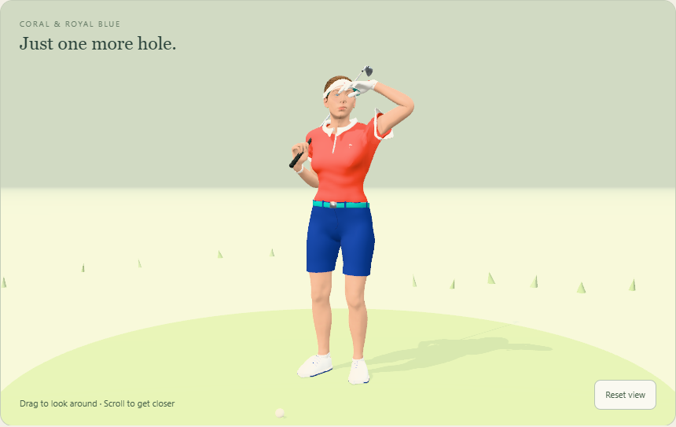
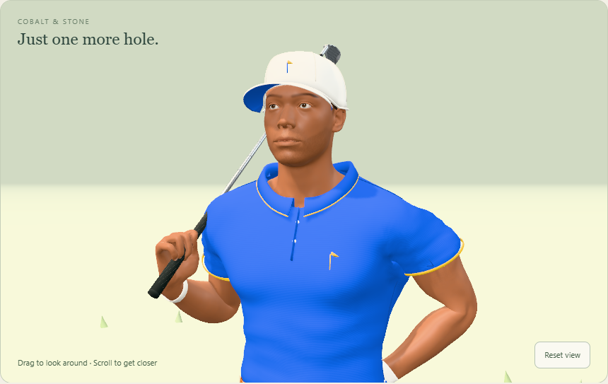
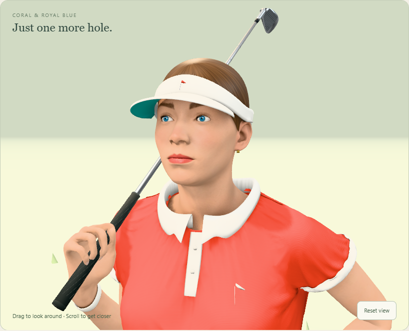
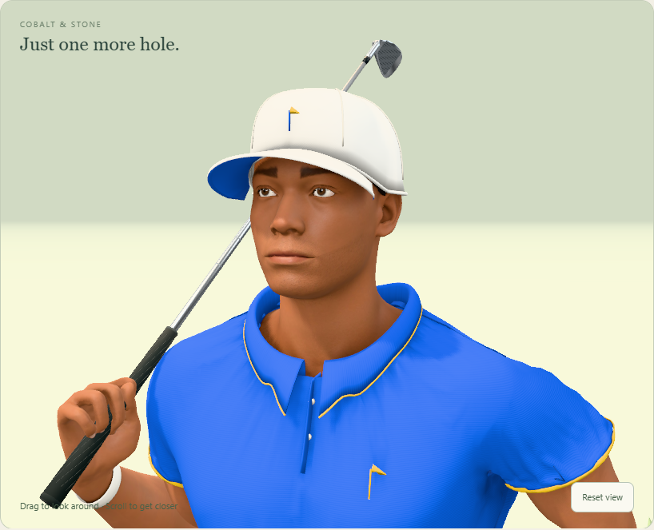
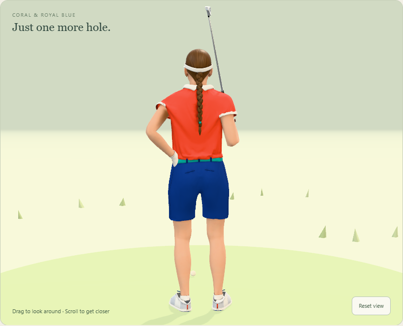
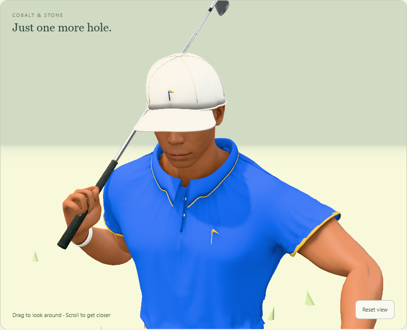

# Banvy golfers, revision 3 (7–8 November)

Both golfers are rebuilt in Blender 5.2: new anatomy, rig, outfits, textures and all twenty animations. A third round, on the night of 7–8 November, made them vivid. It gave them blinking lids, lashes, a structured cap, combed hair, tailoring and livelier motion off the course. It also fixed two long-standing bugs: blank fabric normal maps, and a braid that lagged one-shot clips by a second. See [the third round](#third-round-8-november). A fourth round, on 12 November, drapes the clothes as cloth and paints the skin. It also gives the golfers modelled shoes, a face rig with expressions, two new reactions, a club that rests on the shoulder, and smaller files. See [the fourth round](#fourth-round-12-november). Revision 3 replaces the September golfers in the lab. Those are kept in `experiments/golfer/assets/v1`, and `?golferset=v1` brings them back. Since 8 November the models ship with Spela ([the play mode](../../play-mode.md)), downloaded only when a game starts. The character studio and the lab's course mount stay lab-only.


## See them

Start the lab with `npm --prefix apps/golf run dev:golfer`, then open:

| Page | URL |
| --- | --- |
| Character studio | <http://localhost:5180/golfer-study.html?character=female> (or `character=male`) |
| A clip directly | <http://localhost:5180/golfer-study.html?character=male&motion=SwingDriver&club=Driver&speed=0.25&view=side> |
| On a course | <http://localhost:5180/?bana=puttom&golfer=1&character=female&ljus=dag> |
| The September golfers | add `&golferset=v1` to any of these (dev server) |

Studio parameters: `motion` is any clip name (`Idle`, `Walk`, `Jog`, `AddressIron`, `SwingIron`, `ChipWedge`, `Putt`, `Celebrate` and so on). `club` is `Driver`, `Wood`, `Iron`, `Wedge` or `Putter`. `speed` runs from 0.05 to 2. `view` is `front`, `side` or `back`.

## Design

The characters are original designs.

- **Female, coral and royal blue:**
  - a vivid coral piqué polo with a white collar, sleeve bands and chest flag;
  - royal-blue tailored shorts with belt loops, side seams and a teal belt;
  - a white visor with a teal underbill and a coral flag;
  - chestnut hair combed back into a braid;
  - a white glove with a coral tab;
  - white golf shoes with navy laces and outsoles.
- **Male, cobalt and stone:**
  - a cobalt piqué polo with sunny-yellow tipping and a chest flag;
  - stone tailored trousers with belt loops, side seams, welt back pockets and a cognac belt;
  - a structured white six-panel cap with seams, a button, a cobalt underbill and the flag;
  - a close crop with a squared, faded neckline, and light stubble;
  - a white glove with a cobalt tab;
  - white shoes on gum soles.

The female in September followed a supplied reference to an existing game skin. Revision 3 does not.

- **Bodies:** the realistic female and male from Blender Studio's Human Base Meshes v1.4.1 (CC0), at 1.68 m and 1.80 m. The two share one topology and 102 anatomical face sets. The runtime body uses the first multires level, with the finest sculpt level baked into a normal map.
- **Skin:** baked by Cycles into a 2048² atlas made from the visible UDIM tiles. It carries:
  - tone mottling, and cheek and nose warmth;
  - both lips, painted on the measured mouth line;
  - tapered, arched brows;
  - lid lines and nails;
  - for the male, stubble and the neckline's fade.
- **Eyes:** irises at a human 29° half-angle, with a limbal ring. The lids' soft shading is baked into the eye UVs, and the upper lids and lashes have their own bones.
- **Garments:** cut from the body and tailored. Cloth is lifted off the skin, smoothed so no anatomy shows through, bridged across hollows (each slice blends toward its convex hull) and cut at square hems. The collars, plackets, sleeve bands, belts, shoes, visor and cap are fitted by rays onto the finished surfaces.
- **Fabric detail:** piqué, twill, rib, leather and hair normal maps, all tileable and generated with numpy. Colour maps are stored as sRGB, which is how glTF reads them.
- **Clubs:** the app's own bag clubs (`docs/graphics/clubs`): driver, 3-wood, 7-iron, sand wedge and putter. The male's are fitted 3.5% longer, as a taller player's would be.

The female's pleated skort was replaced by tailored shorts during review. A skinned skirt either splits between the thighs in a golf posture or is pierced by them, and solving that needs cloth simulation.

## Rig

The rig has 66 bones (60 for the male, who has no braid), keeping every name the runtime uses (`Root`, `Hips`, `Thigh_/Shin_/Foot_*`, `Hand_*`, `ClubGrip`). It adds collarbones, a four-part spine, forearm twist bones, three-segment fingers, toes, eyes, upper lids and a six-bone braid.

Every joint is read from the boundary between two face sets: the wrist from forearm and hand, each finger joint from phalanx and phalanx. One routine therefore fits both bodies. Weights come from Blender's bone heat, then are cleaned per finger and toe and limited to four influences.

## Motion

The motion is authored as code in `tools/blender-golfer/v3` and baked at 60 fps. The second round's changes are listed under Verification.

### Full swing

The driver, wood and iron use a kinematic sequence through the P1–P10 positions:

- The pelvis and thorax turn about their own tilted axes. The pelvis leads the downswing, which gives the X-factor stretch, and it shifts and squats.
- The lead arm moves across and up the chest, and the lead wrist hinges, holds its lag and releases.
- The club follows the lead hand, and the trail hand is solved onto the grip.

Each P-position is set by instruction goals, not guessed angles:
- **P2 and P6:** the shaft is parallel to the target line, toe up.
- **Top:** the shaft points at the target.
- **P8:** the shaft is parallel to the target line again.
- **Finish:** the club is behind the neck.

A Levenberg–Marquardt solve turns the goals into arm and wrist angles. It also keeps the trail arm on the club and limits wrist bend.

At impact, the contact point meets the ball exactly with a square face. The keys sit on baked frames, so impact is a stored frame. After impact the head and eyes follow the ball's flight.

### Address, chip, putt and finish

- **Address:** solved per club and per body: stance, ball position, spine tilt, side bend, knee flex and shaft lean. The arms hang naturally, and a taller body flexes more. The address loops breathe, glance at the target and waggle.
- **Chip:** a short stroke, weight forward.
- **Putt:** a shoulder-rock pendulum, with the head turning to watch the roll.
- **Trail foot:** it releases onto its toes, pivoting on the toe tip.

### Hands

The grip is fitted: each finger curls until every phalanx settles tangent to the grip, and the lead thumb lies down the shaft.

### Off the course

The club rests on the trail shoulder, a carry that reads the same with every club length.

- **Gait:** walking and jogging use heel strike, roll over the ball of the foot, toe-off, swing, pelvis rotation and drop, and a free arm that counter-swings.
- **Contact:** feet never sink into the ground, and a leg that can't reach its planted foot lowers the pelvis.
- **Turns:** quarter turns are taken in two steps.
- **Club change:** the club twirls in the fingers.
- **Celebrate:** an anticipation crouch, then the fist punched overhead with a hop off the toes. A soft landing and two fist pumps follow, then a proud stand that turns to the gallery.

### Braid

The braid is a damped verlet chain hanging from the head:
- its joints bend at most 32°;
- it stays off the head;
- it lies on the back, kept there by a collider built from the back's measured profile and carried by the chest;
- its frames carry down the chain;
- looping clips close seamlessly.

## Rebuild

Fetch the CC0 bundle once with `python tools/blender-golfer/fetch_source.py`. Then, from the repository root:

```sh
blender --background --factory-startup --python tools/blender-golfer/v3/build_v3.py -- female
blender --background --factory-startup --python tools/blender-golfer/v3/build_v3.py -- male
```

Each build writes `experiments/golfer/assets/banvy-golfer[-male].glb`, the manifest beside it and `banvy-golfer-v3-<variant>.blend` here. Since the fourth round it takes 5–8 minutes per golfer on all cores. The cloth drape, the per-vertex shading and the skin bake take most of that.

Options:
- `--clips Idle,Walk` bakes a subset;
- `--no-outfit` builds the plain body;
- `--no-export` and `--no-blend` skip the files;
- `--review <dir> <shot+shot>` renders review shots;
- `--audit-only` runs the motion audit alone;
- `--allow-failures` exports despite a failed audit.

While iterating:
- `GOLFER_FAST=1` skips the skin and eye bakes;
- `GOLFER_NO_SHADE=1` skips the per-vertex shading;
- `GOLFER_PARTS=polo,trousers` builds only those outfit steps.

Audits, with `npm --prefix apps/golf run dev:golfer` running:

```sh
node tools/blender-golfer/v3/audit_motion_v3.mjs --metrics-only
node tools/blender-golfer/v3/check_directions_v3.mjs
```

These are copies of the September audits with the same thresholds. They read the grip positions each manifest records (`grip`), and write to `animation-audit/` here. The originals still write to the September folder, so do not run them against revision 3.

## Verification (7 November, second round)

- **Motion audit:** `audit_motion_v3.mjs` passes every check for both golfers and all 20 clips, sampled at 120 Hz:
  - wrist bend at most 68.6° (female) and 69.5° (male), against the 70° limit;
  - hands within 7 mm of the grip;
  - no joint step over 24.6°;
  - soles never below −0.4 mm;
  - impact contact, ball height, strike and face direction;
  - loop seams, planted feet, elbows, knees and arm/leg opposition.
- **Course directions:** `check_directions_v3.mjs` passes for both golfers.
- **Runtime:** both golfers load in three.js on WebGPU with no console errors.

### What the second round changed

- **Grip:** the trail hand sits in line with its forearm, about 30° at address instead of 55°, as in a real overlapping grip. Every swing's wrist path follows from it.
- **Carry:** the shoulder carry has its own grip, with the shaft across the palm, so the wrist stays neutral.
- **Admiring the shot:** after the held finish the full swings stand a little taller and the trail heel settles. The trail hand lets go and falls to the side, its fingers opening, while the lead hand keeps the club behind the neck and the eyes stay on the ball. The manifest records the release time (`trailRelease`), and the audit stops checking the trail grip after it.
- **Swing solve:**
  - A solved key between P9 and P10 keeps both hands on the club as it rises into the finish.
  - The solver aims for a 61° wrist, inside the 70° limit.
  - Limb segments share one hinge axis, so a deep bend can't flip the forearm.
  - The forearm twist bone stays continuous through ±180°.
- **Braid:** it bends at most 32° per joint, its frames carry down the chain from a root that turns by the least rotation, and it is lightly filtered.
- **Clothes:**
  - The cap has a structured front and a D-shaped bill pitched down 13°.
  - The visor band is slimmer.
  - Both bills have a quiet underside.
  - The male's trousers have an easier, straighter leg.

## Third round (8 November)




### Look

- **Vivid palettes:** coral, royal blue and teal for her; cobalt with Swedish yellow for him. In the studio, ACES tone mapping and a green ground light had dulled every colour. It now uses three's neutral tone mapping, a room environment and a warm rim light.
- **Fabric normal maps work.** Since revision 3 began, every fabric normal map had been blank: piqué, twill, rib, leather and hair.
  - The cause: switching a generated image to Non-Color after its pixels are written regenerates it black.
  - The effect: a black normal map tilts every normal, so whites read grey and the polos showed glossy streaks.
  - The fix: `to_image` creates data images as data, then writes, packs and checks the packed pixels. Colour maps are written as sRGB.
- **Eyes:**
  - Upper-lid bones (`Lid_L`, `Lid_R`) pivot at each eye's centre. Their weights fall off from the lid margin.
  - The lids rest 13° lower, over the top of the iris, and follow the gaze down at address.
  - Blinks are a quick close, a short hold and a slower opening. They come with head turns, at rest and in the held finish. The short locomotion loops don't blink.
  - Clumped, curled lashes sit on the lid margin, found by casting rays against the eyeball.
  - The iris is drawn at human size, and the lids' soft shading is baked into the eye.
- **Faces:** her skin is warmer, with a sun flush across the nose and cheeks; both lips on the measured mouth line (the paint reaches the lower lip, which belongs to the chin's face set), with a darker lip line; tapered, arched brows.
- **Hair:**
  - Her hair is combed back into the braid by 116 strand ribbons lying on the scalp over a darker underlayer. Each ribbon has its own UVs along the strand.
  - His neckline is squared and fades into the scalp through the skin bake.
  - The hair cuts snap onto a smooth hairline curve, with no sawtooth edge.
- **Cap and visor:**
  - The cap's six-panel crown is a superellipse on the head's band line, kept a set gap off the skull. It has panel seams, a button, a rolled band and the embroidered flag.
  - Both bills are built as top, underside and rim, so their materials can't leak.
- **Clothes:**
  - **Waist:** the polo is tucked and bloused with gathered folds, the waistband hugs it, and the belt lies on the trousers' real surface. The belt tube's radii had been swapped, making it 7 mm tall and 3 cm deep.
  - **Tailoring:** belt loops, side seams, welt back pockets and a fly.
  - **Polo:** sleeves eased toward their openings; soft folds at the armpits, sleeves and chest; matte piqué.
  - **Collars:** pointed, as a golf polo's are. The leaf runs longer toward the front opening, and his tipping follows the points.
  - **Her fit:** a looser polo and a smaller collar.
- **Shoes:** the collar cut rose the wrong way and opened the whole instep. It now closes over the instep, with visible laces, a rounder toe box and a heel tab. The midsoles are white; his sit on gum outsoles.
- **Details:** an embroidered flag on each chest and on her visor, and a closure tab on each glove.
- **From behind** (the game camera's usual view):
  - a cobalt closure arch and a strap with a clasp on the back of the cap;
  - shoulder and side seams on the polos;
  - a sports watch on each trail wrist: his white with a cobalt bezel, hers slimmer with a coral bezel;
  - her braid's lobes rebuilt as smooth, curved plaits with rounded ends;
  - sleeve openings hemmed round. Each band sits on its opening's real plane and takes the weights of the hem it covers, so it stays closed with the arm akimbo. Nearest-surface weights had given its underside the torso's weights.

### Motion

- **Walk:** a freer arm swing driven from the elbow, stronger pelvis and chest counter-rotation, more hip drop, a push-off pitch, and shoulders that ride the swing.
- **Jog:** the free arm bent at 90° with a loose fist, pumping at chest height, and a livelier club bounce.
- **Idle:** during the long look down the course, the free hand comes up flat under the bill's edge to shade the eyes (it travels on an outward arc, never across the face). Then come a shoulder-rolling stretch with a deep breath, and a double tap of the club on the shoulder.
- **Celebrate:** rebuilt (see Off the course). The fist's path is routed around the shoulder, so the arm never folds through it.
- **Braid timing:** for one-shot clips (turns, swings, the celebration) the bake recorded its one-second warm-up as the clip's start. The braid lagged the body by a second and lost the clip's last second. The bake now records only the clip's own frames.

### Verification (8 November, third round)

- **Motion audit:** `audit_motion_v3.mjs` passes every check for both golfers and all 20 clips:
  - wrist bend at most 68.6° (female) and 69.5° (male);
  - hands within 7 mm of the grip;
  - no joint step over 25°;
  - soles never below −0.4 mm;
  - impact and loop seams as before.
- **Course directions:** `check_directions_v3.mjs` passes for both golfers.
- **Runtime:** both golfers load with no console errors in the studio and on Puttom (`?golfer=1`), on WebGPU. Every capture in this folder was re-shot from the runtime.
- **Builds:** about 40–60 s per golfer, run at high priority on the owner's PC.

## Fourth round (12 November)

The owner asked for AAA character design across the whole character: how they look, animate and move, their clothes and their faces. Every step below is built by the scripts in `tools/blender-golfer/v3`, headless, and is checked on the CPU in the same build.






### Clothes

- **Draped cloth** (`drape_v3.py`). The polo, shorts and trousers had been shells: the body's faces lifted a centimetre and smoothed, with sine-wave folds. Now each is cut like a garment, subdivided, given a few per cent more fabric than its shell and settled over the body by Blender's cloth solver.
  - The polo hangs from the collar seam, the waistband, the sleeve hems and the armpits.
  - The trousers hang from the seat and the waistband. Their hems, carried past the ankle, drape onto the shoes.
  - After the drape, folds that fight their neighbours are calmed, the cloth is relaxed, and it is thinned where it is flat, keeping its seams (`calm`, `relax`, `thin`). The polo goes from 17,112 faces to 11,608.
  - The runtime still skins the cloth: the folds are its rest shape, as a tailored garment's largely are.
- **Skin weights on the denser cloth** keep four influences without a pop between neighbours (the fifth-largest weight is taken off every weight). That removed hatch marks on the chest with an arm akimbo.
- **Sleeve bands** are cut from the sleeve's own cloth, so they follow its folds.
- **Collar:** a stand, roll and leaf from five control points, its edge laid on the draped shirt, in rib knit. The neckline under it is trimmed to the fitted ring.
- **Belt:** a framed metal buckle with a prong, no taller than the belt. The strap's tip runs through a keeper.
- **Glove:** a rolled cuff, three stitched lines and a round tab.
- **Socks** on both golfers.
- **Shoes** (`shoes_v3.py`), modelled as golf shoes:
  - a smooth lofted upper with a round heel and a domed toe box;
  - a padded collar, and a tongue that wraps the front of the ankle;
  - a saddle panel, toe cap and heel counter with stitch lines;
  - crossed laces through eyelets, with a bow;
  - a profiled midsole, and an outsole with soft cleats.

  Every part is weighted to the foot and toe bones only.
- **Baked shading:** every outfit part carries occlusion (folds, creases, contact) baked per vertex into an `AO` colour attribute, which its material multiplies into its colour. A part whose faces point inward is turned first.

### Skin and hair

- **The skin's texture set** (`skin_v3.py`). The body's atlas is first baked into data maps: position, normal, face-set masks, and the CC0 sculpt's own tangent normals, occlusion and curvature. The skin is then painted from them in numpy, in three dimensions, so nothing depends on the UV seams:
  - tone zones and mottling;
  - creases that darken toward red;
  - brows drawn hair by hair, and shaped lips on an analytic lip line;
  - a lash line, nails, knuckles, elbows and knees;
  - freckles for her, and stubble and a faded crop for him.

  It gains a normal map with fine grain, and an occlusion and roughness map: an oilier T-zone, wet lips, glossy nails.
- **Hair:** her mesh strips read as grit from the game camera and are gone. Her hair is one smooth volume whose combed locks come from a flow texture, with strand UVs that converge on the braid and run along each plait. His crop takes a fine grain.

### Face

- **A face rig.** Jaw, mouth-corner, upper-lip, brow and lower-lid bones turn about the skull's centre. They are weighted by fields measured from landmarks on the body.
- **Expressions:** every clip carries one: focus at address, effort at impact, pleasure in the finish, joy in the celebration, a set jaw at a jog.
- **Eye darts** (saccades) off the ball. At address and through a stroke the eyes stay on the ball and its flight.
- **Inside the mouth:** teeth, gums and a tongue stand behind the lips, checked not to show with the mouth at rest.
- **Eyes and lashes:** finer lashes, and wetter eyes.

### Motion

- **Two new reactions:** `FistPump`, for a par saved, and `Disappointed`, for a miss: a palm turned up, a look to the sky and a shake of the head. With `Celebrate`, a golfer has 22 clips. The studio has a button for each.
- **The club rests on the shoulder** (`carry_v3.py`). Until now the carry was placed by eye from the shoulder joint. With the draped polo, the shaft ran 22–52 mm through the shirt and the shoulder under it. Now each carrying clip is baked twice:
  1. The first bake keeps the club in contact, without its authored bounces and lifts.
  2. The posed body and outfit are read by Blender's own armature at every frame of a short clip, and at every second or fourth frame of a long one.
  3. At each frame the carry, hand and club together, rises along the chest until the shaft clears the shirt by its own radius plus 1.5 mm.
  4. The second bake rides the club on the shoulder by those rises, with the authored bounces and lifts on top.

  The shaft keeps its angle across the shoulder. Tilting it about the hand instead, the first attempt, stood it up beside the head. Two motion changes go with this:
  - A walk's sway now slides the club along its own shaft. Sliding it level had raised and lowered the contact by about 2 cm each stride.
  - Its bounce only lifts it off the shoulder, never down into it.
- **Every build audits its own motion on the CPU** (`audit_cpu_v3.py`), with the browser audit's thresholds, every joint interpolated in its parent's space as the runtime does, at 120 Hz. It also measures the carried club against the posed outfit. A failure stops the export (`--allow-failures` overrides it). `--audit-only` runs just the audit.

### Size

`compact_v3.py` rewrites each GLB after export:
- weights become bytes;
- the baked shading becomes bytes;
- normals become shorts (`KHR_mesh_quantization`);
- rotation keys become shorts.

Positions, UVs and key times stay floats. A skinned mesh ignores its node's transform, so quantized positions could not be scaled back. The female's file went from 14.5 MB to 11.1 MB and the male's from 14.2 MB to 10.9 MB. On 8 November they weighed 12.2 and 10.8 MB, so the draped cloth, the shoes, the face and two more clips cost almost nothing. The largest errors are 0.006 in a weight and 2 × 10⁻⁵ in a rotation key. `node tools/blender-golfer/v3/inspect_glb.mjs <glb>` shows where a file's bytes go.

### Review renders

`review_v3.py` renders fixed shots with Cycles, in the build (`--review <dir> face+portrait+strip:SwingIron:front`) or from a saved file. The shots are the same before and after a change, including `carry`, `carry-back` and `carry-jog` for the club on the shoulder. It renders on the CPU by default. Only with the owner's leave, `GOLFER_REVIEW_GPU=1` renders on the GPU and `GOLFER_THREADS=0` uses every core.

### Verification (12 November, fourth round)

- **The build's own checks** pass for both golfers and all 22 clips:
  - the CPU motion audit and the course directions;
  - the carried club in every clip that carries it, which rests 0.9–1.5 mm off the shirt and nowhere enters it.

  The rise that rests the club is about 44 mm for her and 36 mm for him, within 5 mm through a stride. Celebrate and FistPump take a further 8–16 mm where their authored lifts would turn the shaft into the shirt.
- **Motion audit in the browser:** `audit_motion_v3.mjs --metrics-only` passes for both golfers and all 22 clips:
  - wrist bend at most 68.6° (female) and 69.5° (male);
  - hands within 5.2 mm (female) and 7.0 mm (male) of the grip;
  - no joint step over 23.6°;
  - soles never below −0.07 mm.
- **Course directions:** `check_directions_v3.mjs` passes for both golfers.
- **Runtime:** both compacted GLBs load in the studio on WebGPU with all 22 clips and no console errors. The captures above are from that run.
- **Builds:** 6–7 minutes per golfer on all cores, with both built at once. The review renders ran on the GPU.

## Known limits

- **Skinning only:** the cloth is draped in Blender, but in the browser it is skinned, so its folds don't move with the body. The female wears tailored shorts because a skinned skirt tears in golf poses.
- **Assets:** each GLB is about 11 MB. Its textures have been WebP at quality 92 (`EXT_texture_webp`) since 8 November, and its attributes and keys have been compacted since 12 November. There are no LODs, and phone performance is unmeasured.
- **Ball flight:** in the lab it is illustrative, as before.
