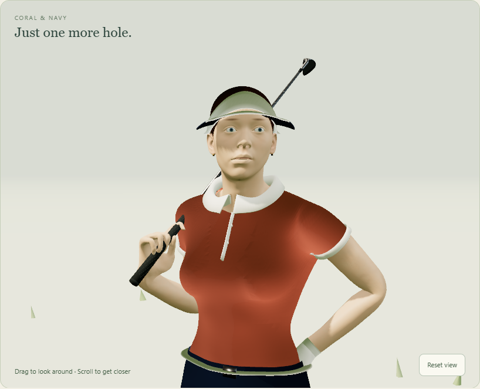
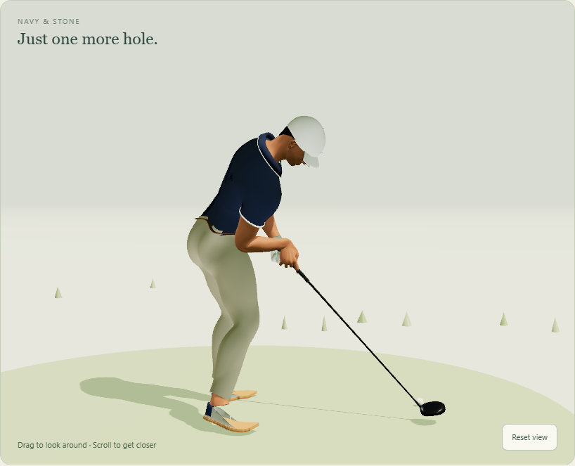

# Banvy golfers, revision 3 (7 November)

Both golfers are rebuilt in Blender 5.2: new anatomy, rig, outfits, textures and all twenty animations. Revision 3 replaces the September golfers in the lab. Those are kept in `experiments/golfer/assets/v1`, and `?golferset=v1` brings them back. The golfer is still a development lab: the production build contains none of it (checked below).




## See them

Start the lab with `npm --prefix apps/golf run dev:golfer`, then open:

| Page | URL |
| --- | --- |
| Character studio | <http://localhost:5180/golfer-study.html?character=female> (or `character=male`) |
| A clip directly | <http://localhost:5180/golfer-study.html?character=male&motion=SwingDriver&club=Driver&speed=0.25&view=side> |
| On a course | <http://localhost:5180/?bana=puttom&golfer=1&character=female&ljus=dag> |
| The September golfers | add `&golferset=v1` to any of these (dev server) |

Studio parameters: `motion` is any clip name (`Idle`, `Walk`, `Jog`, `AddressIron`, `SwingIron`, `ChipWedge`, `Putt`, `Celebrate` and so on). `club` is `Driver`, `Wood`, `Iron`, `Wedge` or `Putter`. `speed` runs from 0.05 to 2. `view` is `front`, `side` or `back`.

## Design

The characters are original designs.

- **Female, coral and navy:** a coral piqué polo with a white collar and sleeve bands, navy tailored golf shorts with a white belt, a white visor, dark-blonde hair pulled back into a braid, a white glove, and white golf shoes with coral heel tabs.
- **Male, navy and stone:** a navy piqué polo with white tipping, stone tailored trousers with a cognac belt, a white cap with a small flag emblem, short dark hair, light stubble, a white glove, and white shoes on gum soles.

The female in September followed a supplied reference to an existing game skin. Revision 3 does not.

- **Bodies:** the realistic female and male from Blender Studio's Human Base Meshes v1.4.1 (CC0), at 1.68 m and 1.80 m. The two share one topology and 102 anatomical face sets. The runtime body uses the first multires level, with the finest sculpt level baked into a normal map.
- **Skin:** baked by Cycles into a 2048² atlas made from the visible UDIM tiles. It carries tone mottling, cheek and nose warmth, lips, brows, lid lines, nails, and stubble for the male.
- **Eyes:** irises baked into the eye UVs.
- **Garments:** cut from the body and tailored. Cloth is lifted off the skin, smoothed so no anatomy shows through, bridged across hollows (each slice blends toward its convex hull) and cut at square hems. The collars, plackets, sleeve bands, belts, shoes, visor and cap are fitted by rays onto the finished surfaces.
- **Fabric detail:** piqué, twill, rib, leather and hair normal maps, all tileable and generated with numpy.
- **Clubs:** the app's own bag clubs (`docs/graphics/clubs`): driver, 3-wood, 7-iron, sand wedge and putter. The male's are fitted 3.5% longer, as a taller player's would be.

The female's pleated skort was replaced by tailored shorts during review. A skinned skirt either splits between the thighs in a golf posture or is pierced by them, and solving that needs cloth simulation.

## Rig

The rig has 64 bones (58 for the male, who has no braid), keeping every name the runtime uses (`Root`, `Hips`, `Thigh_/Shin_/Foot_*`, `Hand_*`, `ClubGrip`). It adds collarbones, a four-part spine, forearm twist bones, three-segment fingers, toes, eyes and a six-bone braid.

Every joint is read from the boundary between two face sets: the wrist from forearm and hand, each finger joint from phalanx and phalanx. One routine therefore fits both bodies. Weights come from Blender's bone heat, then are cleaned per finger and toe and limited to four influences.

## Motion

The motion is authored as code in `tools/blender-golfer/v3` and baked at 60 fps.

### Full swing

The driver, wood and iron use a kinematic sequence through the P1–P10 positions:

- The pelvis and thorax turn about their own tilted axes. The pelvis leads the downswing, which gives the X-factor stretch, and it shifts and squats.
- The lead arm moves across and up the chest, and the lead wrist hinges, holds its lag and releases.
- The club follows the lead hand, and the trail hand is solved onto the grip.

Each P-position is set by instruction goals, not guessed angles:
- **P2 and P6:** the shaft is parallel to the target line, toe up.
- **Top:** the shaft points at the target.
- **P8:** the shaft is parallel to the target line again.
- **Finish:** the club is behind the neck.

A Levenberg–Marquardt solve turns the goals into arm and wrist angles. It also keeps the trail arm on the club and limits wrist bend.

At impact, the contact point meets the ball exactly with a square face. The keys sit on baked frames, so impact is a stored frame. After impact the head and eyes follow the ball's flight.

### Address, chip, putt and finish

- **Address:** solved per club and per body: stance, ball position, spine tilt, side bend, knee flex and shaft lean. The arms hang naturally, and a taller body flexes more. The address loops breathe, glance at the target and waggle.
- **Chip:** a short stroke, weight forward.
- **Putt:** a shoulder-rock pendulum, with the head turning to watch the roll.
- **Trail foot:** it releases onto its toes, pivoting on the toe tip.

### Hands

The grip is fitted: each finger curls until every phalanx settles tangent to the grip, and the lead thumb lies down the shaft.

### Off the course

The club rests on the trail shoulder, a carry that reads the same with every club length.

- **Gait:** walking and jogging use heel strike, roll over the ball of the foot, toe-off, swing, pelvis rotation and drop, and a free arm that counter-swings.
- **Contact:** feet never sink into the ground, and a leg that can't reach its planted foot lowers the pelvis.
- **Turns:** quarter turns are taken in two steps.
- **Club change:** the club twirls in the fingers.
- **Celebrate:** a fist pump.

### Braid

The braid is a damped verlet chain hanging from the head. Its joints bend at most 32°, it stays off the head, its frames carry down the chain, and looping clips close seamlessly.

## Rebuild

Fetch the CC0 bundle once with `python tools/blender-golfer/fetch_source.py`. Then, from the repository root:

```sh
blender --background --factory-startup --python tools/blender-golfer/v3/build_v3.py -- female
blender --background --factory-startup --python tools/blender-golfer/v3/build_v3.py -- male
```

Each build writes `experiments/golfer/assets/banvy-golfer[-male].glb`, the manifest beside it and `banvy-golfer-v3-<variant>.blend` here. It takes about 25 s per golfer. Options: `--clips Idle,Walk` bakes a subset, `--no-outfit` builds the plain body and `--no-blend` skips the native file. Set `GOLFER_FAST=1` to skip the skin and eye bakes while iterating.

Audits, with `npm --prefix apps/golf run dev:golfer` running:

```sh
node tools/blender-golfer/v3/audit_motion_v3.mjs --metrics-only
node tools/blender-golfer/v3/check_directions_v3.mjs
```

These are copies of the September audits with the same thresholds. They read the grip positions each manifest records (`grip`), and write to `animation-audit/` here. The originals still write to the September folder, so do not run them against revision 3.

## Verification (7 November)

- **Course directions:** `check_directions_v3.mjs` passes for both golfers. It covers camera-relative movement, turns, eight aim headings, and ball contact, face and flight with all five clubs on Puttom.
- **Motion audit:** sampled at 120 Hz, `audit_motion_v3.mjs` passes for:
  - impact contact, ball height, strike and face direction;
  - loop seams;
  - feet above ground and planted feet;
  - elbow and knee directions;
  - arm/leg opposition;
  - joint continuity, except as listed below.
- **Still failing** (see `animation-audit/measurements.json`):
  - **Wrists:** the 70° limit is exceeded at the top and through impact of the full swings (79–93°). The shoulder carry exceeds it too (73–81°), its wrist extended as a real carry is.
  - **Grip:** one transient 1.9 cm trail-hand gap in the male's iron swing.
  - **Braid:** one 37° step in the female's iron swing.
- **Repository checks:** the production build passes and contains no golfer file or code. `check-app-build` passes, as does `vitest run apps/golf` (213 files, 1,741 tests).
- **Runtime:** both golfers load in three.js on WebGPU with no console errors.

## Known limits

- **Skinning only:** there's no cloth simulation, so a trouser fold can show a light speck in extreme poses.
- **Assets:** each GLB is about 13 MB, mostly 2048² PNG skin maps and the five clubs. There are no LODs, and phone performance is unmeasured.
- **Ball flight:** in the lab it is illustrative, as before.
- **Wrist extension:** the full swings' trail wrist is more extended than September's 65° clamp allowed.
