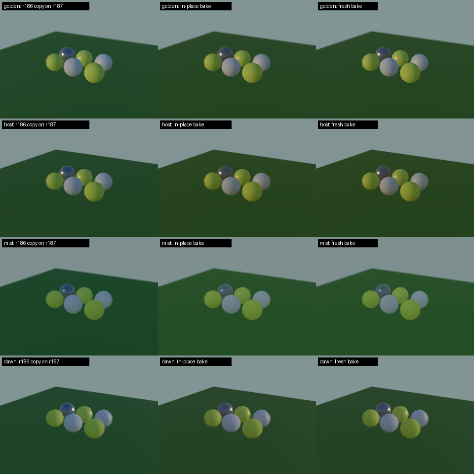
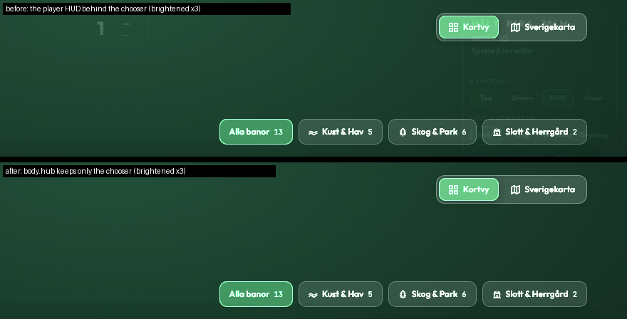

# three.js r187 upgrade and player polish, 2 November

**Owner request, 2 November:** upgrade to three.js r187 and take the graphics,
performance, UI and UX to the next level.

This batch does the upgrade and fixes what it broke, including two silent
interactions with three's internals (the preset-change reflections and the
shadow pass's alpha test), and fixes two UI faults found while surveying the
player. It changes no geometry, placement, source
data, prepared data or tuned light values. Visual acceptance of full courses
still needs the owner's GPU (full courses render black under this container's
SwiftShader); the evidence below is what software rendering and the DOM can
establish.

## 1. three 0.186.0 → 0.187.0

`apps/golf/package.json` pins `three` 0.187.0; the lockfile changes only the
three entries (the local pnpm would also have dropped every `libc` field, so
the file was edited to keep that churn out).

The [r187 migration notes](https://github.com/mrdoob/three.js/wiki/Migration-Guide)
and the export lists were checked against the app. r187 removes:

| Removed in r187 | In this repo |
|---|---|
| `CubeUVReflectionMapping` (PMREMs are now cube render targets, #34585) | not imported, but the lighting environment's **staging copy broke**: see 2 |
| `transformedNormalView`, `transformedNormalWorld`, `transformedClearcoatNormalView` (r177 deprecations, #34517) | `transformedNormalView` was imported, unused, in `main.js`; the build failed until it was removed |
| `VarIntent`, `nodeObjectIntent`, `nodeProxyIntent` | not used |
| `getProjectionDepth` → `projectionDepth`, `ProxyNodeMaterial` → `NodeMaterialInstance`, `pixelationPass` number size, `setViewport`/`setScissor` pixel ratio, custom light registration, struct storage arrays, logarithmic depth under reversed depth | not used |

Other r187 changes the app touches, read in the r187 source:

- **TSL returns nodes, not proxies.** `a.and(b)` is now the `OperatorNode`
  itself, so `golf-cups.test.mjs` read `maskNode.aNode` instead of
  `maskNode.node.aNode`. The cup mask still ANDs into an existing mask, once.
  No runtime code read the proxy.
- **`compileAsync` builds a call's pipelines in parallel** (#34816) and yields
  on a time budget, re-applying each call's own render state around every
  step. `prepare-opening-gpu.mjs` runs four calls at once; that stays safe.
  Whether four still beat one is a hardware measurement.
- **`ShadowNode`** now always renders once after setup and no longer re-runs
  the scene's matrix update inside the shadow pass. The on-demand shadow
  (`autoUpdate = !SHADOW_REST`, `needsUpdate` from the shadow scheduler) keeps
  working the same way.
- **The shadow pass's alpha test is written past the setter.** r186 copied
  each caster's `alphaTest` onto the shared shadow material through the
  setter, whose version bumps churned every caster's cache key; the app's fix
  (`steady-shadow-alpha.mjs`, perf plan item 1.4) replaced that property with
  an accessor over **its own copy**. r187 now writes the material's
  `_alphaTest` directly ("bypass the setter so the version doesn't change"),
  so that copy stayed at 0 and the shadow material read no alpha test for any
  caster. The default crowns cut their shadows with `maskShadowNode` and were
  unaffected, but `?foliageshadow=mip` and any other alpha-tested caster would
  have cast solid shadows. The accessor now keeps the value in `_alphaTest`
  itself: exact on r186's setter path, a no-op on r187's direct write. Two new
  tests fail on the old accessor and pass now.
- **Other internals the app leans on, unchanged in r187:** the WGSL builder's
  `dFdy` is still `-dpdy` (the impostor bake's face normals); dirty-range
  attribute uploads still honour `updateRanges` on both backends (r187 adds
  alignment for sub-4-byte arrays); the shadow pass still takes a caster's
  `maskShadowNode`, `castShadowPositionNode` and `shadowSide`
  (`_getShadowNodes`); `camera._reversedDepth` is still the field; and the
  new light-version cache key (#34949) moves only when a shadow is disposed,
  while the app sets its shadow node once at boot, so the on-demand shadow
  and the no-rebuild preset change are unaffected.
- **TSL type promotion** (#33695) can change how mixed int/float/vector
  operands compile. The tests and the headless boot catch compile errors;
  only the owner's GPU can confirm the pictures.

Bundle cost, production builds of the previous commit and this one:

| Chunk | r186 | r187 |
|---|---|---|
| `three.webgpu` | 706.6 kB (197.8 gzip) | 736.2 kB (205.9 gzip) |
| `three.core` | 377.0 kB (100.5 gzip) | 383.2 kB (101.8 gzip) |
| precache | 2186.2 KiB | 2213.6 KiB (+27.4) |

## 2. The lighting environment after a preset change

`lighting-environment.mjs` kept the displayed environment map's identity stable
by baking each new preset into a staging PMREM and copying it into the
displayed one with `copyTextureToTexture`. Under r187 the PMREM is a
mip-mapped **cube**: WebGPU's default copy is one layer of one mip, and the
WebGL2 fallback binds the source as `TEXTURE_2D`, which a cube cannot be. So
after the first preset, five faces and every rough mip kept the first preset's
sky (WebGPU), or nothing updated at all (WebGL2).

Now every preset after the first is baked **into the displayed cube itself**.
The texture object, its GPU resource and every scene shader stay the same; no
copy is needed on either backend. r187's generator renders the small gradient
scene into its own source cube, uses the PMREM's level 0 only as a blur
intermediate, then refilters every mip, so nothing reads the map it is writing.
A bake that throws (an uninitialised backend) throws before it writes. One
256² half-float cube with mips is owned instead of two.

`tools/check-lighting-reuse.mjs` now renders a third, **fresh** run (a new
lighting environment for every preset) and gates the candidate against it.
Isolated 7-object scene, 160 × 120, WebGL2, SwiftShader, nine preset switches:

| | Max channel error vs a fresh bake, presets 2–9 | Scene shader builds after the first preset | Allocations |
|---|---|---|---|
| r186 staging copy on r187 | **18–34/255** on every preset but noon (stuck on noon) | 0 | 2 |
| In-place bake | **0/255** on all nine | 0 | 1 |

[Report](graphics/three-r187-2026-11-02/lighting-reuse-report.json).

## 3. The course chooser hid the player behind glass, not away

On the bare route (`/`, the chooser), `index.html` still lays out the player's
HUD, which never loads there. It showed through the chooser's 95%-opaque
glass (the hole card's "1 —", the rail's "Spelas 6 m nedför" and camera
buttons), and **Tab walked into 14 dead player controls** behind the chooser.
`hub.js` now marks the body `hub`, and `body.hub` keeps only the chooser, the
boot cover and the toast. A course pick is a full navigation, so the class
never reaches the player.

`tools/check-chooser-ui.mjs` gained the gate. On the build before the fix it
failed both ways: "courseNav, card, rail, leftStack, holesContainer, mini,
hint, tourCard" laid out, and Tab reaching "menuToggle, btn, …, holeNextBtn".
After it, both pass and so does the rest of the harness.

## 4. The keyboard shortcuts the menu promised

The menu's "Kortkommandon" listed 1–9 and 0 for holes, C for the camera,
L for the light and F for a flight; the only handler knew the arrows, N/P,
H and M. Five of seven listed keys did nothing, and the working ones were not
listed. The toggle's tooltip also said "(Esc)" opens the menu; Esc only closes
things, so the tooltip now just says "Öppna meny".

`engine/keyboard-shortcuts.mjs` turns a key into one named action, and the
menu renders its list from the same table (`SHORTCUT_ROWS`):

| Key | Action |
|---|---|
| 1–18 | type the hole's number; a 1 on an 18-hole course waits 0.7 s for a second digit, 2–9 answer at once |
| 0 | hole 10 |
| ← → (N, P) | previous / next hole |
| C | next camera view: Tee → Green → Fritt → Ovan |
| L | next light, in the rail's order, with a toast naming it |
| F | start / stop the flight (the rail's Flygtur button) |
| M | signs: off, holes, facilities |
| H | hide / show the UI (ends a safari, as before) |
| Esc | close the menu (unchanged) |

A camera key during a flight or safari ends it first without a return tween,
as the rail's flight button does. Keys do nothing while the chooser or the
menu drawer (a modal dialog) is open, or while typing in a field; a pending
hole number is dropped when one of those opens. A held key's auto-repeat steps holes only
with the arrows; a held F or H would otherwise flicker the flight or the clean
view, and a held 1 would type 11. `keyboard-shortcuts.test.mjs`
covers every hole 1–18, nine-hole courses, ordering, and that every key the
menu lists reaches an action.

## Next, for the owner's GPU

These need eyes on the real adapter, so they are proposals, not changes:

1. **Opening compile time on r187.** `compileAsync` now builds in parallel;
   measure `prepare-opening-gpu.mjs` at concurrency 1, 2 and 4 with
   `tools/benchmark-gpu-startup.mjs` before touching it.
2. **Cascaded sun shadows.** The r186 notes named cascades as the one feature
   worth wanting. r187's `TileShadowNode` gained reversed depth, layers and
   per-tile sampling (#34784–#34787). A cascade pilot behind a switch would
   keep the snapped box as the before; the tree-shadow rules in CLAUDE.md
   (`check-tree-shadows.mjs`) are its acceptance.
3. **Contact occlusion at high quality.** `GTAONode`'s false self-occlusion is
   fixed in r187 (#34718). Ground relief already bakes horizon occlusion;
   screen-space AO would add it under buildings, flags and the golfer. It
   costs a normal/depth MRT on the scene pass, so measure first.

## Verification

| Check | Result |
|---|---|
| Frozen lockfile install | pass, three 0.187.0 |
| `pnpm --filter @banvy/golf build` | pass |
| `node tools/lint-app.mjs` | pass |
| `pnpm exec vitest run apps/golf` | **1267/1267**, 163 files |
| `tools/check-lighting-reuse.mjs --baseline HEAD` (fresh gate) | pass, 0/255 |
| `tools/check-chooser-ui.mjs` | new gate fails before, passes after; the whole harness passes |
| `node packages/course-v2/check-app-build.mjs` | pass |
| `pnpm check:course-workflow` | pass |

Not established here: full-course appearance on WebGPU and WebGL2, the
opening-scene compile time on r187, and phone frame rates. Run
`tools/check-three-rendering.mjs` (its `--presets` pass exercises the preset
changes this batch fixed) with `BANVY_GPU=1` against a production build.
