# Banvy UI/UX redesign: audit and specification (25 November 2026)

**Status:** proposal for the owner's review. No application code has changed.
Implementation starts only after the wireflows (section C) and layout blueprints
(section D) are approved. Section G lists the decisions this needs from the owner.

The brief: audit and redesign the whole interface (information architecture,
navigation, menus, buttons, HUDs and visual design) for desktop and mobile. The
benchmark is the restraint of Apple Maps and Flighty in a calm Nordic register.
The 3D terrain is always the hero, and phone Lätt 3D has a budget of three or four
pinned elements.

## How this was grounded

- **Build:** `main` at `da3b42d6`, built with `pnpm --filter @banvy/golf build` and
  served from `apps/golf/dist`.
- **Start menu, club list, Bro Hof's club picker, the course setup sheet in all three
  modes, Statistik and Inställningar:** captured in Chromium at 1440 × 900 and 390 × 844.
- **Lätt 3D:** Veckefjärden hole 5 with simulated GPS at the tee and mid-fairway. The
  Score, Hålet and Meny sheets, the camera menu and Solläge were captured at
  390 × 844 (59 px notch and 34 px home bar), 844 × 390 (side insets) and
  1440 × 900.
- **Detaljerad 3D:** the same hole at 1440 × 900 and 390 × 844, with `q=lo` and the
  3D loop paused once loaded. The HUD is HTML, so it measures true.
- **Simulator:** at 390 × 844, with its menu and shot panel. The desktop capture timed
  out loading the golfer models in software rendering, so its desktop layout is read
  from `play-hud.mjs`.
- **Code read:** `hub.js`, `shell/home.js`, `rail.js`, `club-picker.js`,
  `course-sheet.js`, `menu.js`, the `map-session.js` HUD template, `play/play-hud.mjs`
  and `play-mode.mjs` key handling, the player HUD in `index.html`, and every
  stylesheet.
- **Prior decisions read:** the audits of [8](ui-audit-2026-11-08.md),
  [18](ui-audit-2026-11-18.md), [21](ui-audit-2026-11-21.md) and
  [25 November](ui-audit-2026-11-25.md), plus [the map mode](course-map-mode.md),
  [the club wheel](club-wheel.md) and [the start menu](start-menu.md).

The pictures come from SwiftShader. They establish layout, type, targets and
contrast against flat colours. They do not establish GPU colour, frame rate or
legibility in sunlight, so every outdoor claim below is a hypothesis for the Phase 4
field study. Two earlier audits deliberately left the Lätt 3D HUD unchanged until it
had been seen on a real phone in a round. This spec respects that: its Lätt 3D HUD
ships behind a switch and is accepted only by that study (section F, Phase 4).

## Summary: five moves

1. **Place before mode.** Golfers think "Bro Hof, Castle, play", not "GPS mode, which
   course?". The front door becomes a club lobby. The mode becomes a three-way switch
   on the club page, chosen once.
2. **One club, one page.** The club picker dialog and the setup dialog merge into a
   single linkable club page. On it, a multi-course club's layouts are a segmented
   control (Stadium | Castle), not a modal.
3. **Four pinned things in Lätt 3D:**
   - hole chip;
   - distance card, which absorbs GPS accuracy and wind;
   - the shot cluster: the wheel and Logga slag;
   - **Meny**.

   Everything else becomes contextual or moves one tap away into the Meny sheet.
4. **One control bar and one inspector in Detaljerad 3D.** Today the same camera,
   tool and light controls live in three places: the right panel, the drawer tiles and
   the phone quick actions. Keep one.
5. **One token set, one colour grammar, one key map.** Yellow means "this is your
   number and your action", green means "on, live, locked". The same key does the
   same thing in every mode.

---

## A. Audit

### A0. Before, as captured

Phone captures at 390 × 844 and 844 × 390, device scale 2, from the build above. The
Lätt 3D captures have simulated GPS mid-fairway on Veckefjärden's 5th; Detaljerad 3D
is on the same hole.

<p>
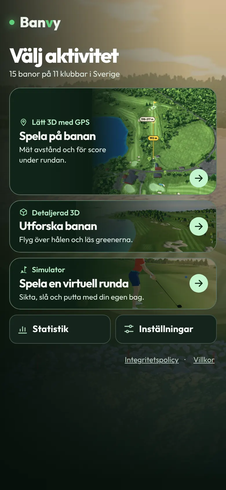
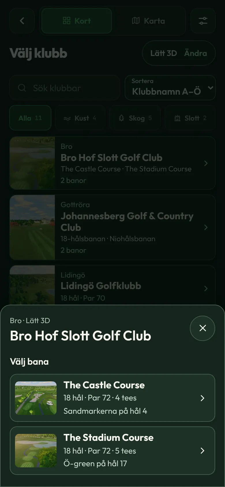
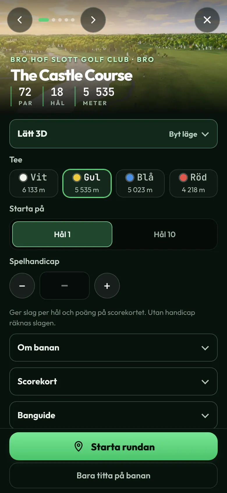
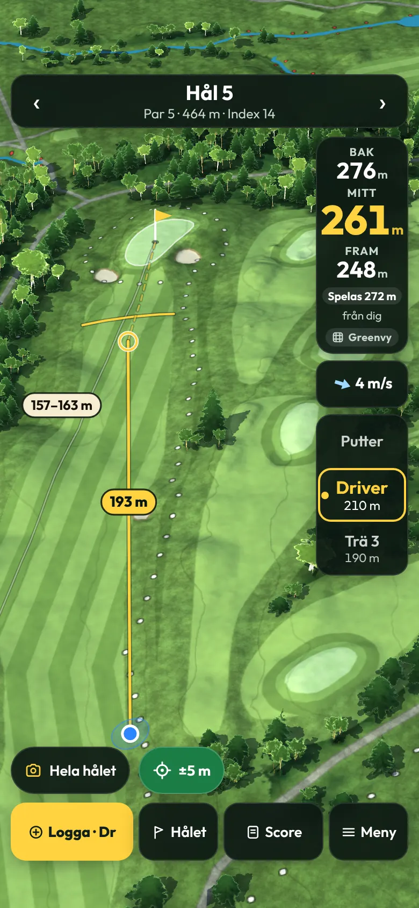
</p>
<p>
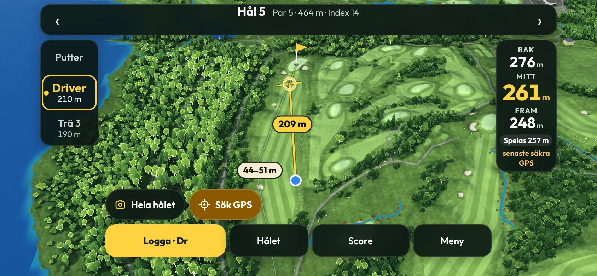
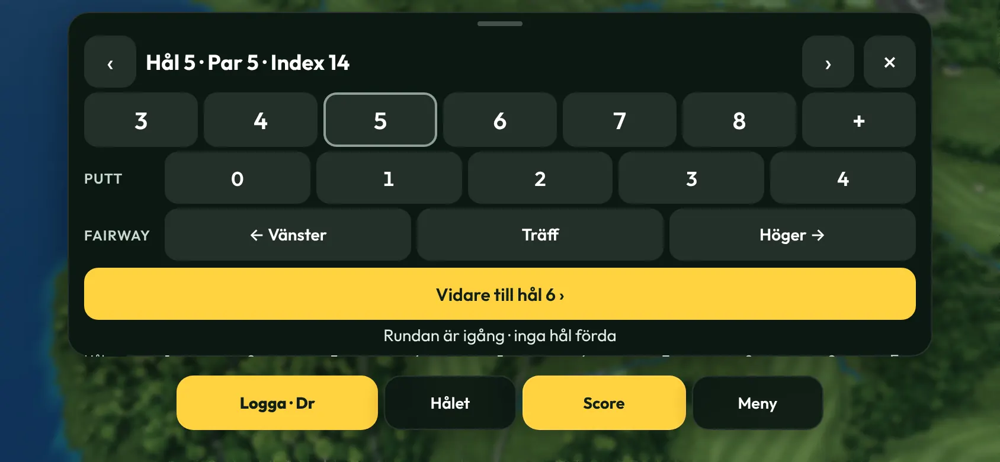
</p>
<p>
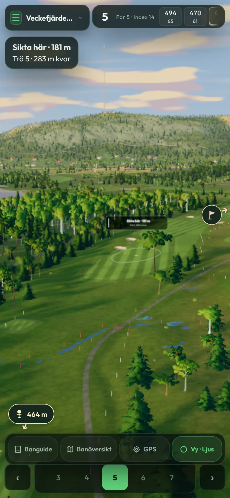
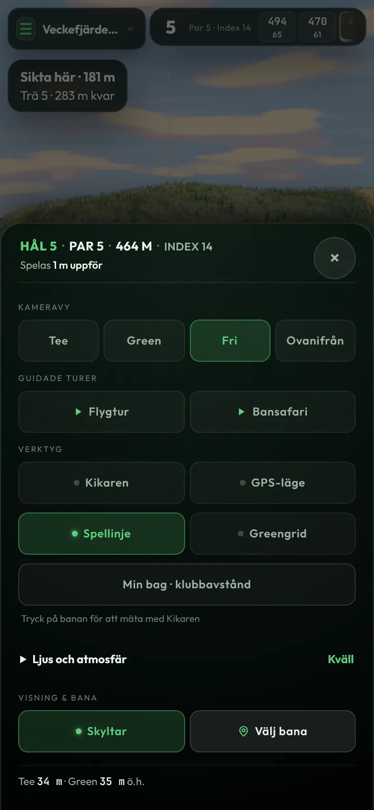
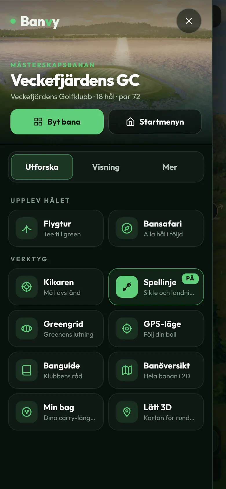
</p>

In reading order:
1. the mode-first front door;
2. Bro Hof's picker, the first of two stacked dialogs;
3. Castle's setup, with the mode asked again;
4. Lätt 3D's six pinned clusters;
5. the landscape map band;
6. the landscape Score sheet, whose card sits at the fold, with three yellow controls
   at once;
7. Detaljerad 3D on a phone: the truncated course name, tee chips running off the
   edge, an aim label too small to read in the 3D, four quick actions and the hole
   strip;
8. its *Vy · Ljus* sheet;
9. its drawer, which repeats the sheet's tools as tiles.

### A1. The bottlenecks, ranked by impact

#### 1. The front door asks for the mode before the place, then asks again

- **Evidence:** `home.js` opens on *Välj aktivitet* with three mode cards. The course
  list (`rail.js`) carries the mode as a pill (*Lätt 3D · Ändra*). The setup sheet
  (`course-sheet.js`) asks again under *Byt läge*.
- **Bro Hof's Castle Course from a cold start:** Lätt 3D card, then Bro Hof, then *The
  Castle Course*, then *Starta rundan*. That is four taps through two stacked dialogs:
  the `club-picker.js` dialog at `#karta/klubb/bro-hof`, then the setup dialog at
  `#karta/bro-hof-castle`. A one-course club takes three.
- **Why it matters:** the mode is a property of *how* you use a course today, not of
  the course. Forcing the choice first makes a first-time golfer choose between
  three abstractions before seeing a single club. Two stacked modals also make
  Back ambiguous.

#### 2. A club's other courses vanish once one is picked

- **Evidence:** the setup sheet shows one layout and has no Stadium ⇄ Castle switch.
- **Switching inside Lätt 3D today:** *Meny → Bana & läge → Byt bana*, which loads the
  start menu's list, then Bro Hof, then Stadium, then *Starta rundan*. That is six taps
  and two page loads.
- **Switching inside Detaljerad 3D:** drawer, *Byt bana*, Bro Hof, Stadium: four taps
  and a reload that forgets the tee. `courseUrl` keeps only `bana`, `hero`, `gl`, `q`,
  `det` and `karta`.
- **Four of the eleven clubs have two layouts:** Bro Hof, Upsala, Johannesberg and
  Veckefjärden.

#### 3. Lätt 3D pins six clusters and eleven targets on a phone

- **Evidence:** at 390 × 844 these are always on screen:
  - the hole bar (‹, title, ›);
  - the distance card (Bak/Mitt/Fram, *Spelas*, *från dig*, *Greenvy*);
  - the club wheel;
  - the camera pill (*Hela hålet*);
  - the GPS pill (*±5 m*);
  - four dock buttons (*Logga · Dr*, *Hålet*, *Score*, *Meny*).

  The wind chip joins them in landscape and on wider screens. The HUD covers
  **22.7%** of the portrait screen and **29.4%** in landscape
  (measured, section A3).
- **Landscape (844 × 390):** the clear map is about 562 × 217 px, between the hole
  bar, the wheel, the distances and the camera and GPS pills. The Score sheet shows
  291 of its 582 px, so its card starts at the fold; the Meny sheet cuts its tee
  chips the same way.
- **Smallest type on the most-glanced card:** *från dig* and *Spelas 257 m* are
  10.5 px and *Greenvy* is 10 px, beside a 38 px *Mitt*.

#### 4. Detaljerad 3D repeats itself, and the Simulator crowds a phone

- **Desktop (1440 × 900), six pinned clusters and over 40 targets:**
  - course pill (top left);
  - hole card with six tee chips (top centre);
  - right panel (camera ×4, tours ×2, tools ×5, lights, signs, *Välj bana*);
  - aim readout and hole-guide text (bottom left);
  - 18-button hole strip with ‹ › (bottom centre);
  - minimap (bottom right).

  Hole, par, length and index appear in the hole card *and* in the panel header. The
  hole's name appears in the card *and* the guide. The panel's *Ovanifrån* button is
  clipped at the right edge at 1440 px.
- **The drawer duplicates the panel:** its *Utforska* and *Visning* tiles click the
  panel's own buttons (`menu.js`). On a phone, *Flygtur*, *Bansafari*, *Kikaren*,
  *GPS-läge*, *Spellinje*, *Greengrid* and *Min bag* each appear in the drawer *and*
  in the *Vy · Ljus* sheet. *Banguide*, *Banöversikt* and *GPS* appear a third time
  as quick actions.
- **Phone (390 × 844):** the course name truncates (*Veckefjärde…*), and the tee chips
  run off the hole card's right edge.
- **The Simulator on a phone pins seven clusters:**
  - the scorebug, whose hole name truncates (*Strategiskt …*);
  - the distance panel;
  - camera and menu buttons;
  - the conditions card;
  - the hole map;
  - club and *Slag*;
  - the swing pad with its *Dra | Tryck* switch.

  The right column fills the top 315 px, so the course and the golfer sit in a band
  between the panels. Its numbers mix JetBrains Mono (*4,0 m/s*, *210 m*) with Outfit
  (*461 m*).

#### 5. Three visual dialects and two accent colours

- **Map:** primary action and "chosen" are yellow `#ffd23f`.
- **Start menu, setup sheet and Detaljerad 3D:** the primary action is turf green
  `#5fd07a`.
- **Simulator:** a broadcast glass with JetBrains Mono labels.
- **Measured across the 11 style sources** (`index.html`, `styles/*.css`,
  `play-hud.mjs`, `bag-editor.css`):
  - about **255** distinct hex colours;
  - **66** distinct font sizes;
  - **54** distinct border radii;
  - about **105** custom properties, each defined file by file. There is no shared
    token file.
- **Mixed signals:** the same "selected" state is a yellow fill in the map, a green ring
  in the setup sheet and a green fill in the hole strip. Tee *names* (Vit, Gul) are set
  in JetBrains Mono (`course-sheet.css`), so a code face carries words.

#### 6. The same key does different things in each mode

| Key | Detaljerad 3D | Lätt 3D (desktop) | Simulator |
|---|---|---|---|
| `C` | camera view | camera view | spin + |
| `V` | — | — | camera view |
| `G` | — | green view | course guide |
| `H` | hide the HUD | side panel | hide the HUD |
| `M` | signs (Skyltar) | Meny | hole-map size |
| `S` | — | scorecard | height − |
| `R` | — | recentre | replay |
| `Esc` | close the menu | clear the measurement or close | **open** the menu |

Sources: `engine/keyboard-shortcuts.mjs`, the map's own shortcut list in
`map-session.js`, and `play-mode.mjs` lines 1213–1236.

#### 7. Half the mode switches are missing, and one loses your place

| From ↓ to → | Lätt 3D | Detaljerad 3D | Simulator |
|---|---|---|---|
| **Lätt 3D** | — | *Meny → Bana & läge → Utforska hål 5 i Detaljerad 3D*: keeps the hole | *Meny → Bana & läge → Öppna simulatorn*: `playUrl(slug)` with no hole or tee (`map-session.js:595`), so hole 1 from the default tee |
| **Detaljerad 3D** | drawer → *Lätt 3D*: keeps the hole and tee | — | **none**: only through the start menu |
| **Simulator** | **none** | **none** | — |

The Simulator's menu offers *Fortsätt spela*, *Spara och lämna* and *Avsluta
rundan*, so it is a dead end for both mode and layout.

#### 8. Defects visible in the captures

| Where | What | Fix |
|---|---|---|
| Lätt 3D score sheet, 390 px | Each nine is 468 px wide in a 342 px card and scrolls sideways with no cue: on hole 5 only holes 2–8 and 10–16 show | Card scrolls as one 9-hole block with a visible edge fade, or Ut/In on two rows |
| Lätt 3D dock | *Logga · Dr*, *Logga · T3*: an abbreviation on the primary button | **Keep** (corrected in Phase 1): the tag names the club, or the hole being played before the next one takes over ([the club wheel](club-wheel.md)). In the v2 HUD the wheel sits directly above the button, which can then say *Logga slag* |
| Lätt 3D distance card | *från dig* and *Spelas 257 m* at 10.5 px, *Greenvy* at 10 px | 13 px floor for on-course text (E2); *Greenvy* becomes a chevron |
| Setup sheet | Empty handicap shows "–" in a box between − and +, which reads as a value | Placeholder *Ingen*, and the field becomes a number input on tap |
| Setup sheet | Tee names in a monospace face | Outfit; mono digits only where columns must align |
| Detaljerad 3D, desktop | Drag hint is 10 px `--faint` text straight on the terrain, under the 11 px floor | Show once in a toast, then never; or remove |
| Detaljerad 3D, desktop | *Ovanifrån* clipped in the right panel at 1440 px | Moves into the control bar's segmented control (D4) |
| Detaljerad 3D, phone | Tee chips overflow the hole card; course name truncated | Tee moves to a chip with a menu; the course pill shows the short layout name |
| Simulator shot panel, phone | The five-way *Form* control wraps, leaving *Stor fade* alone on a second line; the panel prints keyboard keys (*T typ · Q E form …*) on a touch screen | *Form* as a five-stop slider; key hints only with a fine pointer |
| Club list | Four rows of chrome (top bar, title and mode, search and sort, category chips): 236 px (28% of the screen) before the first club on a phone | Search and sort in one row; categories go into the filter menu |

### A2. Cut list: what to remove, merge or demote

**Lobby, club and setup**

| Today | Action | Goes to |
|---|---|---|
| *Välj aktivitet* home with three mode cards | **Remove** as the entry screen | The lobby. A mode is chosen on the club page. *Fortsätt* cards keep their own mode |
| Mode pill *Lätt 3D · Ändra* on the club list | **Remove** | Club page |
| Club picker dialog (`#…/klubb/<id>`) | **Merge** | Club page's layout switch |
| Setup dialog (`#karta/<slug>`, `#3d/<slug>`, `#spela/<slug>`) | **Promote** from dialog to a page | Club page (linkable; Back means back) |
| *Byt läge* disclosure in the sheet | **Promote** to a visible three-way segmented control | Club page, directly above the button |
| Category chips (Kust 4, Skog 5, Slott 2) | **Demote** | Filter menu beside Sortera |
| *Kortvy* / *Sverigekarta* toggle | **Demote** to one map icon button | Lobby header |
| Statistik and Inställningar as large home cards | **Demote** | Tab bar on a phone, header links on a desktop |
| *Om banan*, *Scorekort*, *Banguide* accordions | **Merge** into one tabbed *Om banan* section | Club page, below the setup |

**Lätt 3D on a phone**

| Pinned today | Action |
|---|---|
| Full-width hole bar ‹ title › | **Shrink** to a hole chip; swipe and ‹ › stay; a tap opens the hole sheet |
| *Hålet* dock button | **Merge** into the hole chip's tap |
| *Score* dock button | **Merge**: the hole chip shows the round (`+2`); the sheet has a Score tab; the putt question on the green stays automatic |
| GPS pill (*±5 m*, *Sök GPS*) | **Merge** into the distance card's footer as a status dot; a full banner only when something is wrong |
| Wind chip | **Merge** into the distance card's footer |
| *Greenvy* text cue on the distance card | **Remove**; a chevron says the card opens the green |
| Camera pill and its popover | **Demote** to the Meny sheet's top row: still two taps (Meny, then the view), as today (pill, then the view), but no longer pinned. The distance card still opens Green in one tap; `C` cycles on a keyboard |
| Dock *Meny* | **Keep** the label: one sheet with *‹ Klubbar* in its header, the camera views and Dag/Natt in its top row, and three tabs (*Score · Bana · Visning*) |
| Recentre | **Keep**, but only while the view has moved |
| Desktop key-hint row | **Remove**; `?` opens the shortcut sheet and every control has a tooltip with its key |

**Detaljerad 3D**

| Today | Action |
|---|---|
| Right panel (*Kameravy*, *Guidade turer*, *Verktyg*, *Ljus*, *Visning & Bana*) | **Becomes the inspector**: collapsible, tabs *Hål · Verktyg · Ljus*, closed by default under 1600 px |
| Drawer tiles that click the panel's buttons | **Remove**: the drawer is navigation only (course, club, mode, Startmenyn, Statistik, Inställningar, shortcuts) |
| Phone quick actions (four buttons) | **Merge** into one sheet handle (*Verktyg · Ljus · Guide*) |
| 18-button hole strip | **Replace** with a stepper ‹ 5/18 ›; tap the number for a hole grid |
| Hole card with every tee chip | **Keep** the hole header; the tee becomes one chip with a menu |
| Panel header repeating the hole | **Remove** |
| Aim readout card *and* the in-world aim label | **Keep one per view**: the readout when the label would be under 12% of the screen's height (the floor the 18 November audit proposed) |

**Simulator**

| Today | Action |
|---|---|
| Separate distance panel under the scorebug | **Merge** into the scorebug as its second row |
| Conditions card with weather row | **Shrink**: wind dial and lie %; weather in the dial's tooltip and the menu's *Ljus* tab |
| Menu without a mode switch | **Add** *Visa hålet i Detaljerad 3D* and *Byt bana* (keeps the checkpoint) |

### A3. Measurements

| Measure | Value | How |
|---|---|---|
| Taps, cold start → Castle GPS round | 4 (a one-layout club: 3) | hub routes and captures |
| Castle → Stadium inside Lätt 3D | 6 taps, 2 page loads | the map's Meny markup |
| Castle → Stadium inside Detaljerad 3D | 4 taps, 1 reload, the tee forgotten | `courseUrl` in `router.js` |
| Lätt 3D → start menu | 3 taps from the default *Runda* tab | `data-home` sits in *Bana & läge* |
| Lätt 3D pinned, 390 × 844 | 6 clusters, 11 targets, **22.7%** of the screen | DOM rectangles, on-course state |
| Lätt 3D pinned, 844 × 390 | 7 clusters, 12 targets, **29.4%**; clear map ≈ 562 × 217 px | the same |
| Distance card type | *Mitt* 38 px; *Bak*/*Fram* 21 px; *från dig*, *Spelas* 10.5 px; *Greenvy* 10 px | computed styles |
| Landscape Score sheet | 291 of 582 px visible | sheet `clientHeight`/`scrollHeight` |
| Portrait scorecard | each nine 468 px wide in a 342 px card | `scrollWidth`/`clientWidth` |
| Club list on a phone | 236 px of chrome (28%) before the first club | DOM |
| Detaljerad 3D, 1440 × 900 | 6 clusters, over 40 targets; the hole shown in 3 places | captures |
| Style sources (11 files) | ~255 hex colours, 66 font sizes, 54 radii, ~105 local custom properties | `grep` over the sources |
| Outfit tabular figures | yes (`1111` 60.5 → 94.4 px, `0000` 106.6 → 94.4 px) | Chromium, bundled font |

Every Lätt 3D target already meets 44 px on touch (the smallest is 44 × 44), so the
problem there is count and coverage, not size.

### A4. What already works, and stays

- **Lätt 3D's core loop:**
  - large, right-aligned numbers;
  - the hold-to-log with its instant receipt (*Driver 179 m*, *Ångra*, *Plikt +1*);
  - the single putt question;
  - one contextual card at a time;
  - `fitLayout` keeping the dot, aim point and pin clear of every panel.
- **Solläge's legibility.** The Dag material generalizes it.
- **The boot screen:** mode, course, hole, three stage words and a way back.
- **The setup sheet's content:** tee chips with their lengths, the scorecard read from
  the pack, the guide and your *Snitt*. It moves intact onto the club page.
- **The Simulator's broadcast layout,** and its discipline of hiding panels until the
  golfer has loaded.
- **History:** Back closes one layer, and the place and focus are restored
  (`panel-history.mjs`, the hub's `rememberScreen`).
- **Search** across club, layout, town and par, with or without diacritics.

---

## B. Information architecture

### B1. Hierarchy

```text
Banvy
├── Lobby · Klubbar                          #            phone tab 1
│   ├── Fortsätt   live GPS round · Simulator checkpoint · last opened
│   ├── Nära dig   only when location is already granted, ≤ 5 km
│   ├── Search · Sortera · Filter · Lista | Karta
│   └── Club cards ×11   cover · name · place · layout chips
├── Club page · Bro Hof Slott Golf Club      #klubb/bro-hof?bana=bro-hof-castle&lage=karta&tee=2&hal=1
│   ├── Layout switch   Stadium | Castle    (absent for one-layout clubs)
│   ├── Hero            posters · par · holes · length from the tee · weather now
│   ├── Setup           tee · start hole · handicap (Lätt 3D, Simulator) · light (Detaljerad 3D)
│   ├── Mode            Lätt 3D | Detaljerad 3D | Simulator
│   ├── Action          Starta GPS-runda | Utforska i 3D | Starta simulatorn  (+ one secondary)
│   └── Om banan        Scorekort · Banguide · Din historik
├── Active view
│   ├── Lätt 3D         ?bana=…&karta=1&hal=&tee=
│   ├── Detaljerad 3D   ?bana=…&hal=&tee=&vy=
│   └── Simulator       ?bana=…&spela=1&hal=&tee=
│       ├── HUD             ≤ 4 pinned on a phone, ≤ 5 clusters on a desktop
│       ├── Overlays        sheet (phone) · inspector (desktop) · popovers
│       └── Quick settings  in the sheet or inspector → Inställningar for the rest
├── Statistik                                 #statistik          phone tab 2
└── Profil · Inställningar                    #installningar      phone tab 3
```

The player URLs keep their grammar (`bana`, `karta`, `spela`, `hal`, `tee`, `ljus`,
`vy`), so `main.js` is untouched. The bare route still loads no 3D engine. Old hub
hashes (`#3d`, `#karta`, `#spela`, `#…/klubb/<id>`, `#karta/<slug>`) redirect to the
lobby or the club page with `lage=` set. Shared links survive, as
[legacy URL compatibility](legacy-url-compatibility.md) already does for the HTML
pages.

### B2. One club, one page: single and multiple layouts

| | One-layout club (Visby, Lidingö …) | Multi-layout club (Bro Hof) |
|---|---|---|
| Lobby card | Cover, name, place, `18 hål · Par 70` | Cover, name, place, chips **Stadium** · **Castle** |
| Tap the card | Club page | Club page on the last-played layout, else the host layout (Stadium) |
| Tap a chip | — | Club page with that layout selected |
| Search *castle* | — | A layout hit: *The Castle Course · Bro Hof* opens the club page on Castle |
| Layout switch | Absent: no empty control | Segmented control under the hero; switching rewrites the URL in place (`replaceState`) with no navigation |
| Taps to start a round | 2: card, button | 2: chip or card, button. Today: 4 |

Labels in the switch are the short layout names (`layoutLabel`): *Stadium | Castle*,
*Stora banan | Mellanbanan*, *18 hål | 9 hål* (Johannesberg),
*Mästerskapsbanan | Korthål*. The hero carries the full name. Tee chips are matched
by colour when the layout changes (Gul is Castle's second tee and Stadium's third,
as `savedTee` already resolves).

### B3. Switching without losing state

| Switch | Kept | Reset | Today |
|---|---|---|---|
| Layout on the club page | mode, tee colour, start hole | — | needs Back and a different dialog |
| Layout inside a view (*Meny → Bana*) | mode, tee colour | hole → start hole; a live round on the old layout is **paused**, never ended, and shows on *Fortsätt* | 6 taps and 2 loads |
| Mode inside a view (*Meny → Bana → Läge*) | layout, hole, tee; the measured point into the Simulator only, which `play/` can read (`main.js` reads no new parameter) | camera to the mode's default | Lätt 3D → Simulator loses the hole and tee |
| Back from a view | club page with its layout, tee and mode | — | the hub restores the list and sheet |
| Orientation | everything; the sheet becomes a side panel | — | sheets clip in landscape |

New storage: one key per club for its last layout (`banvy-club-layout-v1:<club>`).
Per-layout tees (`banvy-map-tee-v1:<slug>`), rounds, checkpoints and the last
launch mode already exist and keep their keys.

---

## C. Wireflows

### C1. Discovery and launch

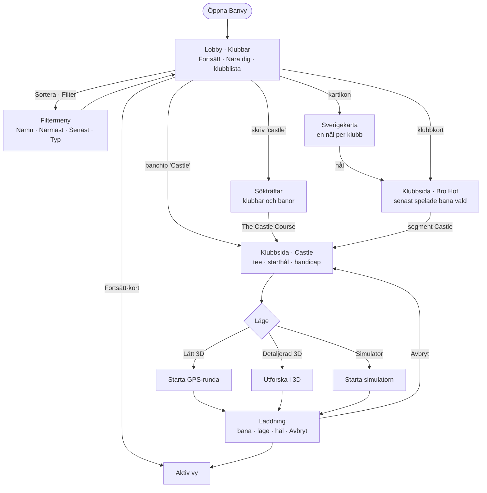

| State | Screen notes |
|---|---|
| Lobby | Large title *Klubbar* that collapses into the search bar on scroll. At most two *Fortsätt* cards; on a phone the live GPS round comes first, on a desktop the Simulator. *Nära dig* only with permission already granted (no prompt on the front door, as today). |
| Search | Matches club, layout, town and par with or without diacritics (today's `searchText`). A layout match is its own row and opens on that layout. |
| Club page | Opens on the last-played layout. The mode is preselected in this order: a live round's mode; else Lätt 3D when the phone is within 5 km; else the device default (phone Lätt 3D, desktop Detaljerad 3D). |
| Mode | Changing the mode changes the button's label and the setup rows below the tee (handicap or light) in place. |
| Loading | The existing boot screen, plus **Avbryt**, which returns to the club page with its state. |

### C2. Lätt 3D on the course (phone)

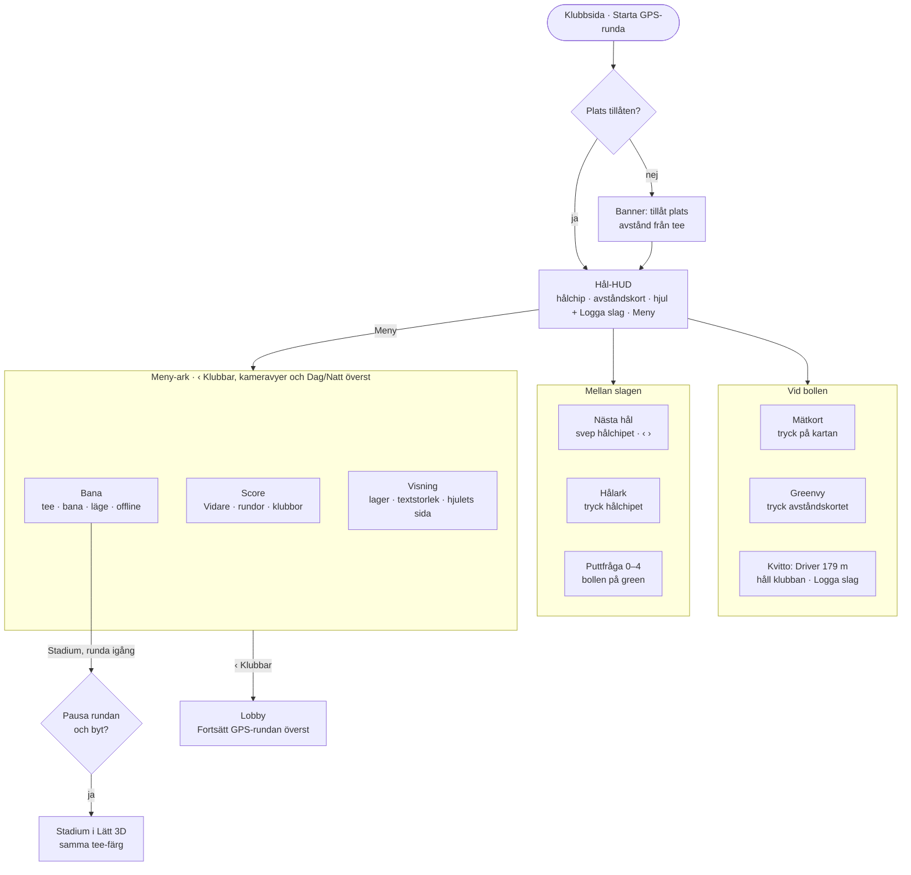

Every overlay returns to the HUD the same way: a swipe down, `Esc`, Back or its own
action (*Automatiskt*, *Vidare*, a chosen hole). The diagram leaves those edges out.

| State | Screen notes |
|---|---|
| Hole HUD | Exactly four pinned elements (D3). The map never sits under a panel at the golfer's dot, the aim point or the pin: today's `fitLayout` rule, kept. |
| Measure card | Appears above the bottom bar, one card at a time (today's rule). *Automatiskt* replaces *Rensa*: it names what you return to. |
| Green view | The distance card stays; the rest of the HUD dims to 40% and ignores touch until you return. |
| Receipt | A toast above the bar for 6 s, with *Ångra* and *Plikt +1*. The wheel band turns green at the ball (today's lock sign). |
| Hole sheet | Half height, map visible above. Hazards are rows that measure on tap (today's *Hinder · tryck för att mäta*). |
| Meny sheet | Header: *‹ Klubbar*, the course, close. Top row on every tab: the camera views and Dag/Natt. Three tabs: **Score** (the card, *Mina rundor*, *Mina klubbor*, Statistik), **Bana** (tee, layout, mode, offline) and **Visning** (layers, text size, wheel side). It reopens on the tab last used in this round. |
| Leaving | Two taps: *Meny*, then *‹ Klubbar*. A live round is never ended by leaving. |

GPS has its own state machine; section D5 shows it.

### C3. Desktop: explore and simulate

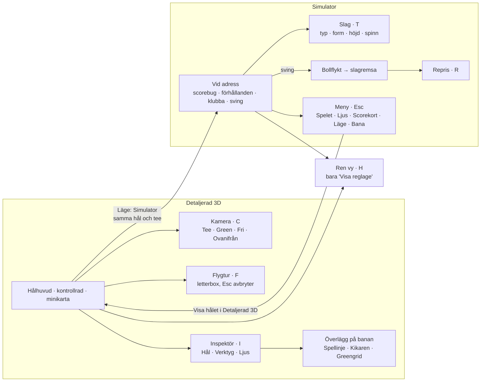

As in C2, each overlay returns by `Esc`, Back or its own control; `H` toggles clean
view back.

| State | Screen notes |
|---|---|
| Detaljerad 3D | Three pinned clusters plus the minimap (D4). The inspector remembers whether it was open. |
| Overlays | Spellinje, Kikaren and Greengrid are toggles with a visible on-state (switch dot), never styled like the primary action (the blueprint's own complaint about the panel). Wind, height and club read in the aim readout, not in a second card. |
| Simulator | The broadcast layout stays: it is the most coherent HUD in the app. It gains the shared tokens and key map, a merged scorebug and a mode switch in its menu. |
| Clean view | `H` everywhere. One chip, *Visa reglage*, top right in the safe area; any key or tap on it restores the HUD. |

---

## D. Layout blueprints and edge states

Zones are named **pinned** (always visible), **one tap** (a sheet, popover or
inspector opened by one action) and **settings** (Inställningar or a sheet's last
tab). Sizes are CSS px. "Safe" means the `env(safe-area-inset-*)` of that edge.

### D1. Lobby

**Desktop, 1440 × 900**

```text
┌──────────────────────────────────────────────────────────────────────────────┐
│ ● Banvy   [⌕ Sök klubb, bana eller ort    /]  Statistik  Inställningar  (O)  │  64
├──────────────────────────────────────────────────────────────────────────────┤
│ FORTSÄTT                                                                     │
│ [▣ ● GPS-runda · Bro Hof Castle · hål 7 · +3 →] [▣ Simulator · Visby · h4 →] │  88
│                                                                              │
│ Klubbar 11                    Sortera: Namn ▾   Filter ▾   [ Lista | Karta ] │  44
│ ┌──────────────────────┐  ┌──────────────────────┐  ┌──────────────────────┐ │
│ │ cover 16:9           │  │ cover 16:9           │  │ cover 16:9           │ │  3 columns ≥ 1200 px
│ │ Bro Hof Slott GC     │  │ Johannesberg G&CC    │  │ Lidingö GK           │ │  2 columns ≥ 760 px
│ │ Bro                  │  │ Gottröra             │  │ Lidingö              │ │
│ │ [Stadium] [Castle]   │  │ [18 hål] [9 hål]     │  │ 18 hål · Par 70      │ │
│ └──────────────────────┘  └──────────────────────┘  └──────────────────────┘ │
└──────────────────────────────────────────────────────────────────────────────┘
```

**Phone portrait, 390 × 844**

```text
┌──────────────────────────────┐
│ Klubbar                  (O) │  large title 32, a 44 px bar on scroll
│ [⌕ Sök klubb, bana, ort    ] │  44
│ ┌ ● FORTSÄTT ──────────────┐ │
│ │ ▣ GPS-runda · Castle h7 →│ │  72
│ └──────────────────────────┘ │
│ ⌖ Nära dig · Bro Hof 1,2 km  │  48, only with location already granted
│ Alla klubbar     Namn ▾   ⌖  │  40
│ ▣ Bro Hof Slott Golf Club    │  76 per row
│   Bro · [Stadium] [Castle]   │
│ ▣ Johannesberg G&CC          │
│   Gottröra · [18] [9]        │
│ …                            │
├──────────────────────────────┤
│ Klubbar · Statistik · Profil │  tab bar 49 + safe-bottom
└──────────────────────────────┘
```

**Phone landscape, 844 × 390:** no large title. A 44 px bar holds search, sort and
the map toggle. *Fortsätt* is one row, the list is two columns, and the tab bar is
compact (32 px). Content is inset by the left and right safe areas.

| Zone | Desktop | Phone portrait | Phone landscape |
|---|---|---|---|
| Pinned | header (search, Statistik, settings, account) | title or search bar; tab bar | compact bar; compact tab bar |
| One tap | sort and filter popover, map view, every club | the same | the same |
| Settings | default sort, region | the same | the same |

### D2. Club page

**Desktop**

```text
┌────────────────────────────────────────────┬─────────────────────────────────┐
│ ‹ Klubbar   Bro Hof Slott Golf Club · Bro  │                                 │
│                                            │ [   Stadium    |    Castle    ] │  layout switch
│   posters 16:10   ‹ ›   ● ○ ○ ○            │ Tee [●Vit] [●Gul] [●Blå] [●Röd] │
│                                            │ Starta på    [ Hål 1 | Hål 10 ] │
│   The Castle Course                        │ Spelhandicap       [ −  18  + ] │
│   72 PAR · 18 HÅL · 5 535 M                │ ─────────────────────────────── │
│   7° · 4 m/s SV · byar 9                   │ [ Lätt 3D | Detaljerad | Sim. ] │  mode
│                                            │ [      Starta GPS-runda       ] │  primary, 52
│   Om banan | Scorekort | Banguide          │      Bara titta på banan        │  ghost
│   Din historik: 3 rundor · bäst +6         │                                 │
└────────────────────────────────────────────┴─────────────────────────────────┘
```

**Phone portrait**

```text
┌──────────────────────────────┐
│ ‹                       Dela │  over the poster, safe-top
│                              │
│      posters (38dvh)         │
│ BRO HOF SLOTT GC · BRO       │
│ The Castle Course            │  28
│ 72 par · 18 hål · 5 535 m    │
├──────────────────────────────┤
│ [   Stadium   |   Castle   ] │  44, sticky under the poster
│ Tee   ●Vit  ●Gul  ●Blå  ●Röd │  chips 44
│ Starta på         [ 1 | 10 ] │
│ Spelhandicap      [ − 18 + ] │
│ Om banan | Scorekort | Guide │  tabs
│ …                            │
├──────────────────────────────┤  sticky action bar
│ [Lätt 3D | Detaljerad | Sim] │  40
│ [     Starta GPS-runda     ] │  52
│      Bara titta på banan     │  32 + safe-bottom
└──────────────────────────────┘
```

**Phone landscape:** two columns. The poster takes the left 45% at full height,
with the title over it. The setup scrolls on the right, and the action bar is sticky
at the foot of the right column.

| Zone | Desktop | Phone portrait | Phone landscape |
|---|---|---|---|
| Pinned | back, layout switch, mode, action | back, action bar (mode and button) | back, action bar |
| One tap | tee, start hole, handicap or light, *Om banan* tabs, posters | the same, by scrolling | the same |
| Settings | default mode, handicap, light | the same | the same |

### D3. Active Lätt 3D HUD

**Phone portrait (primary), 390 × 844 with a notch.** These four elements are pinned:

1. **Hole chip** (top left): hole, par, length, the round so far (`+2`) and ‹ ›. Swipe
   or ‹ › change the hole; a tap opens the hole sheet.
2. **Distance card** (top right): Bak, **Mitt**, Fram and *Spelas*. Its footer holds the
   wind arrow and speed and a GPS dot with its accuracy. A tap opens the green.
3. **Shot cluster** (right, thumb): the wheel's three rows above **Logga slag**, which
   is the only full-colour button. Holding a club still logs (0.9 s).
4. **Meny** (bottom left).

```text
┌──────────────────────────────┐
│ [‹ 5 ›  Par 5 · 464 m   +2]  │  (1) hole chip, 44 high; safe-top 59 above
│                    ┌───────┐ │
│                    │BAK 276│ │  (2) distance card, 96 wide
│                    │MITT   │ │
│                    │  261  │ │  Mitt 44 px, tabular
│                    │FRAM248│ │
│                    │↗4 ●±5 │ │  wind · GPS dot
│                    └───────┘ │
│         3D map (hero)        │
│     aim line · carry pills   │
│                    ┌───────┐ │
│                    │Putter │ │  (3) shot cluster: the wheel …
│                    │▸Driver│ │
│                    │ Trä 3 │ │
│                    └───────┘ │
│ [≡ Meny]  [⊕ Logga slag   ]  │  (4) Meny 48 · … and Logga slag 56; safe-bottom 34 below
└──────────────────────────────┘
```

Contextual elements appear one at a time above row (4): the measure card, the
receipt, the putt question, the GPS banner and the recentre chip.

**Phone landscape, 844 × 390.** The wheel moves to the left edge (today's rule) and
Logga slag goes bottom right. *Meny* sits bottom left under the wheel. No element
spans the width, so the map keeps the whole centre band. A sheet opens as a **right
side panel**, `min(420px, 50vw)` wide and full height, so it never clips at 290 px,
and the hole stays visible on the left.

```text
┌──────────────────────────────────────────────────────────────┐
│ [‹ 5 ›  Par 5 · 464 m  +2]                     ┌──────────┐  │
│ ┌──────┐                                       │BAK   276 │  │
│ │Putter│              3D map                   │MITT  261 │  │
│ │▸Drivr│                                       │FRAM  248 │  │
│ │Trä 3 │                                       │↗4   ●±5  │  │
│ └──────┘                                       └──────────┘  │
│ [≡ Meny]                                  [⊕ Logga slag  ]   │
└──────────────────────────────────────────────────────────────┘
```

**Desktop and tablet (≥ 1024 px).** Keep today's arrangement, which already works:
- left inspector (*Hålet · Score · Meny*, as today) at 360 px, collapsible with `I`;
- hole header top centre;
- distance card and wheel on the right;
- camera segmented control, GPS and Logga slag bottom centre.

Remove the key-hint row; `?` replaces it.

| Zone | Phone portrait | Phone landscape | Desktop |
|---|---|---|---|
| Pinned | (1) hole chip, (2) distances, (3) wheel and Logga slag, (4) Meny | the same four, in corners | header, distances and wheel, bottom bar, inspector |
| One tap | hole sheet · Meny sheet (views and Dag/Natt on top; Score, Bana, Visning) · green view · measuring | side panel instead of sheet | inspector tabs |
| Settings | Större text, wheel side, Solläge default, layers, relief | the same | the same |

### D4. Active Detaljerad 3D and Simulator HUD

**Detaljerad 3D, desktop 1440 × 900**

```text
┌──────────────────────────────────────────────────────────────────────────────┐
│ [≡ Veckefjärden ▾]  [5 Strategiskt andraslag · Par 5 · 464 m · ●Gul ▾]   [◧] │  56
│                                                         ┌──────────────────┐ │
│                                                         │ INSPEKTÖR        │ │  320, closed < 1600 px
│                         3D (hero)                       │ Hål|Verktyg|Ljus │ │
│                                                         │                  │ │
│  ┌────────────────────┐                                 └──────────────────┘ │
│  │ Sikta här · 181 m  │  only with Spellinje               ┌──────────────┐  │
│  │ Trä 5 · 283 m kvar │                                    │ minimap      │  │  M
│  └────────────────────┘                                    └──────────────┘  │
│       [‹ 5/18 ›]   [ Tee | Green | Fri | Ovanifrån ]   [▸ Flygtur]           │  control bar, 48
└──────────────────────────────────────────────────────────────────────────────┘
```

**Detaljerad 3D, phone portrait**

```text
┌──────────────────────────────┐
│ [≡] [5 · Par 5 · 464 m    ▾] │  the hole chip opens the hole grid
│                              │
│          3D (hero)           │
│                              │
│ [Sikta 181 m · Trä 5]        │  contextual
│ [‹] [Tee|Green|Fri|Ovan] [›] │  control bar, 48
│ [ ⌃ Verktyg · Ljus · Guide ] │  sheet handle, 56 + safe-bottom
└──────────────────────────────┘
```

**Simulator, desktop:** four corners and one transient strip.
- **Top left:** the scorebug, with the distance ladder as its second row.
- **Top right:** the conditions card (wind dial, lie %), with the hole map under it.
- **Bottom left:** club and *Slag*.
- **Bottom right:** the swing pad.
- **Bottom centre:** the shot strip, after a shot only.
- **Top right row:** camera and menu, plus *Repris* after a shot (as today).

**Simulator, phone portrait:**
- **Top:** a compact scorebug (hole, to pin, stroke), and a wind chip at the top
  right that opens the conditions.
- **Bottom:** club bottom left, swing pad bottom right.
- **In a sheet:** the hole map.

**Simulator, phone landscape:** the desktop's corners at compact sizes.

| Zone | Desktop | Phone portrait | Phone landscape |
|---|---|---|---|
| Pinned (Detaljerad 3D) | nav pill + hole header, control bar, minimap, inspector toggle | nav + hole chip, control bar, sheet handle | the same as portrait in corners; control bar bottom centre |
| Pinned (Simulator) | scorebug, conditions, club + slag, swing | scorebug, wind chip, club, swing | the same, compact |
| One tap | inspector tabs, hole grid, tee menu, light | sheet tabs | side panel |
| Settings | quality, frame cap, developer overlay, signs default | the same | the same |

### D5. Mobile and 3D edge states

**Viewport and safe areas**
- Every full-height root uses `100dvh`. The map already does (`#courseMap`).
  `index.html` still sizes the minimap (line 149) and the panel's maximum height
  (line 273) from `100vh`. Change both, or they run under Safari's toolbar.
- `viewport-fit=cover` is set. Every pinned element offsets by its edge's safe area.
  Landscape adds the left and right insets: the notch side moves with the rotation.
- Sticky action bars pad with `max(12px, env(safe-area-inset-bottom))` so the home
  indicator never overlaps a button.
- When the keyboard opens on the lobby search, the tab bar hides and results fill to
  `100dvh`.

**Loading**

| State | UI |
|---|---|
| Course pack | The existing boot screen (mode, course, hole, the three stage words), plus **Avbryt** back to the club page |
| First frame | HUD with real hole data and terrain at its first ring; panels never show "–" placeholders (the Simulator already holds its panels back while the golfer loads) |
| Terrain or trees streaming | A 2 px progress hairline under the hole chip; never a blocking spinner |
| Graphics failure | Today's recovery (*Försök igen*, *Öppna sparad karta*), plus a third action, *Öppna i Lätt 3D*, which needs neither WebGPU nor three.js |
| Offline course not saved | The club page's button is disabled, with *Spara för offline när du har nät* |

**GPS (Lätt 3D)**

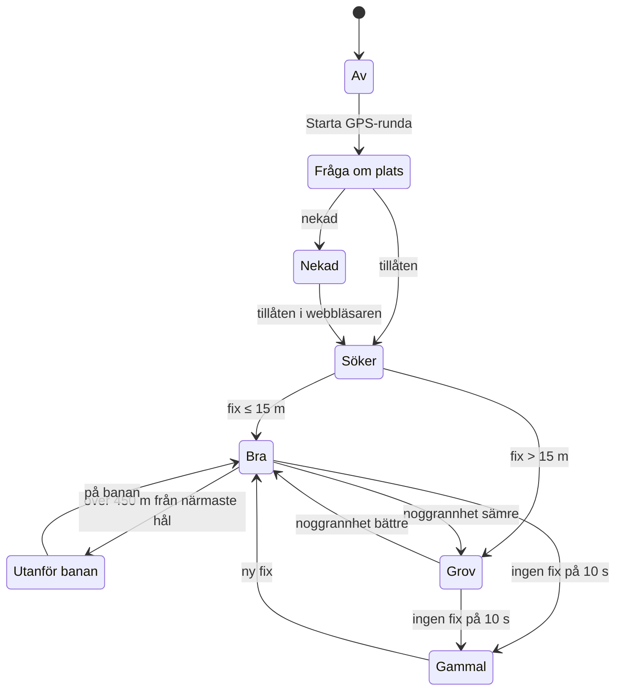

| State | Distance card | Banner (above the bottom bar) |
|---|---|---|
| Av | `från tee` under the numbers | — |
| Söker | numbers from the tee; pulsing grey dot | — |
| Bra (≤ 15 m) | numbers from you; green dot `±5` | — |
| Grov (> 15 m) | numbers in ink-2; amber dot `±28` | *Osäker position: slaglängder sparas inte* (once per hole) |
| Gammal (> 10 s) | numbers in ink-3 with *för 40 s sedan* | — (a hold to log waits up to 10 s, as today) |
| Utanför (> 450 m from the nearest hole) | `från tee` | *Du är inte på banan · 1,6 km bort*; dismissible |
| Nekad | `från tee` | Persistent until dismissed: *Tillåt plats för sidan i webbläsarens inställningar* (the 18 November wording) |

Thresholds are the existing ones: ±15 m stops shot lengths, a fix over 10 s old is
not trusted, and 450 m from the nearest hole is off the course (`OFF_COURSE_METRES`).
Only the presentation is new.

**Orientation:** a rotation keeps the hole, camera, measured point, open sheet and
wheel position. The sheet becomes a side panel and back again. The map re-runs
`fitLayout`; Detaljerad 3D keeps its camera. Nothing reloads.

**Pointer and gesture isolation**
- **HUD roots** are `pointer-events: none` with `auto` on their children. The map
  does this today; Detaljerad 3D's panels must too, and Simulator panels
  already do.
- **Ownership:** only the 3D canvas takes `touch-action: none`. Panels take
  `manipulation` (no double-tap zoom), and scrolling sheets take `pan-y` with
  `overscroll-behavior: contain`.
- **Containment:** a sheet's header owns vertical drags, and a drag that starts on any
  HUD element never reaches the camera. That holds today because the gesture
  listeners sit on the canvas (`map-gestures.mjs`, the orbit controls), and panels
  are its siblings. The rule is to keep it so: no camera listener on `document` or
  `window`.
- **Pocket safety:** the hold-to-log cancels when the finger moves more than 10 px. A
  swipe on the hole chip needs 48 px horizontal travel and less than 30° from the
  horizontal. The 18 November audit's lit-screen-in-a-pocket concern stands, so a
  *Låt skärmen släckas* option is in *Meny → Visning*.
- **Long press:** suppress the system callout on the map
  (`-webkit-touch-callout: none`), since a long press there means hold-to-log or
  drag the point.

**Interruptions**
- **Lock, then unlock:** GPS shows *Gammal* until a new fix, and the hole is kept (it
  already is, for six hours).
- **Offline:** a small offline glyph in the hole chip; saved courses work fully.
- **Reduced motion:** sheets and camera flights cross-fade instead of sliding or
  flying, and the wheel snaps.

---

## E. Visual system, buttons and menus

### E1. Surfaces and colour roles

There are two materials. **Natt** is dark glass, the default for desktop and for
indoor modes. **Dag** is white with black ink: today's Solläge, generalized.

Lätt 3D chooses between them by the sun at the course, using `solar.mjs` (already
shared with the map): Dag while the sun is more than 6° up, Natt otherwise. That is
*Auto*; the Meny sheet's top row overrides it in one tap. A dark panel in direct sun
only mirrors the sky, as `course-map.css` itself says.

The tokens live in `apps/golf/src/styles/tokens.css` (Phase 1). Every value below
already ran in the app before it became a token. The Dag column is the map's
Solläge, which the owner has used on the course.

| Token | Natt | Dag (`.bv-dag`) | Use |
|---|---|---|---|
| `--bv-surface-glass` | `rgba(9,18,14,.78)` | `#fff` | Detaljerad 3D, Simulator and start menu panels |
| `--bv-surface-solid` | `rgba(12,24,18,.92)` | `#fff` | Lätt 3D panels and sheets: they must read in daylight |
| `--bv-surface-2` · `-3` | `rgba(255,255,255,.10)` · `.14` | `rgba(0,0,0,.08)` · `.13` | a control at rest, pressed; the segmented track and thumb |
| `--bv-hairline` · `-strong` | `rgba(160,230,185,.14)` · `rgba(150,220,175,.18)` | `rgba(0,0,0,.18)` · `.2` | 1 px borders; every floating panel has one, so it holds its edge over white sky |
| `--bv-ink-1` | `#ffffff` | `#000000` | numbers, titles |
| `--bv-ink-2` | `#b7c8bc` | `#27332c` | body |
| `--bv-ink-3` | `#849c8f` | `#4a574f` | captions |
| `--bv-signal` | `#ffd23f` (flag) | `#000000` | **your number**: the *Mitt* yardage, the aim line, the chosen club |
| `--bv-action` · `--bv-on-action` | `#ffd23f` · `#10201a` | `#000000` · `#ffd23f` | **your action**: the one primary button |
| `--bv-turf` · `--bv-turf-hi` | `#5fd07a` · `#8ef0a4` | the same, as fills and icons only | **on, live, locked**: GPS good, live round, toggle on, brand dot |
| `--bv-warn` · `--bv-danger` | `#f0a23a` · `#ef7c67` | the same, as fills and icons only | rough GPS and stale data; denied and delete |
| `--bv-water` · `--bv-sand` | `#4bb4d8` · `#e2cf9a` | the same | hazard pills and rows |
| `--bv-under` · `--bv-over` · `--bv-link` | `#7fe39a` · `#ffb48a` · `#9fd8ff` | `#0b6b34` · `#a33a00` · `#084a85` | scores and links, as text |
| `--bv-focus` | `#dafbe3` | `#000000` | the focus ring |

Contrast, computed with the WCAG formula through each panel's translucency over
three backgrounds (black, a fairway at `rgb(110,160,80)` and white sky):

| | ink-1 | ink-2 | ink-3 | flag | turf |
|---|---:|---:|---:|---:|---:|
| Glass (.78) over a fairway | 13.8 | 7.9 | 4.7 | 9.6 | 7.1 |
| Glass (.78) over white sky | 9.7 | 5.5 | **3.3** | 6.7 | 5.0 |
| Solid (.92) over white sky | 14.7 | 8.4 | 5.0 | 10.2 | 7.6 |

So a caption on the glass that can sit over sky takes `ink-2`. That means the hole
header and the inspector at the top of Detaljerad 3D (Phase 3); a more opaque glass
is the alternative. On Dag, the inks reach 13.2 (ink-2) and 7.6:1 (ink-3); the
action's flag ink on black reaches 14.5:1. Turf (1.9:1) and warn (2.1:1) are
never text on Dag, which is why the map's Solläge sets scores in its dark
`under`, `over` and `rough`.

**The grammar,** applied in every mode:
- **Flag yellow** is reserved for the one primary action on a screen and for the
  golfer's own numbers: the *Mitt* yardage, the aim line and the chosen club's ring.
  This is the map's established rule ("yellow is what is chosen"), applied
  app-wide. The start menu's green buttons become yellow.
- **Turf green** never means "press me". It means on, live or locked.
- **A selected option** (segment, chip, tab) is the neutral raised thumb
  (`surface-3` + `ink-1`), never an accent. A screen then has exactly one yellow
  thing to press.
- **Over terrain,** every panel has the hairline and `shadow-1`, so it holds its edge
  over bright grass, white sky and dark tree shadow alike. Phase 4 checks this with
  sampled backgrounds.

### E2. Typography and numerals

Outfit is the one family. It has tabular figures: at 40 px bold, `1111` and `0000`
measure 60.5 and 106.6 px proportionally and 94.4 px each with
`font-variant-numeric: tabular-nums` (measured in Chromium with the bundled
woff2). JetBrains Mono, used 54 times outside the map (the numbers in Detaljerad
3D, the Simulator, the start menu and the setup sheet, and the tee names), is
therefore dropped. That removes a visual dialect and six font files, and the map
already does without it.

Tabular figures are used wherever a number updates under the eye or aligns in
columns: HUD distances, scorecards and carry tables. Proportional figures are used
in running text.

| Token | Size / line | Weight | Use |
|---|---|---|---|
| `--bv-type-hero` | 44/44 (56 with *Större text*) | 800, tabular | *Mitt* yardage; Simulator *Till hål* |
| `--bv-type-title1` | 32/36 (phone 28/32) | 800 | lobby title, layout name |
| `--bv-type-title2` | 24/28 | 700, tabular | Bak/Fram, score totals |
| `--bv-type-title3` | 20/24 | 700 | card titles, hole chip |
| `--bv-type-headline` | 17/22 | 650 | buttons, list titles |
| `--bv-type-body` | 15/20 | 500 | body |
| `--bv-type-footnote` | 13/18 | 500 | secondary lines |
| `--bv-type-caption` | 11/14, caps +0.08em | 650 | labels (BAK, MITT, FRAM): **the floor** |

Rules:
- Nothing is set under 11 px.
- On-course text a golfer reads at a glance is at least 13 px, and HUD numbers at
  least 20 px.
- Units are a third of their number's size, at 80% opacity (today 13 px beside 38).

### E3. Space, shape, elevation and motion

| Family | Values |
|---|---|
| Spacing (4 px grid) | 4 · 8 · 12 · 16 · 20 · 24 · 32 · 48 |
| Radius | 6 chip · 10 control (desktop) · 14 control (phone), card · 20 sheet, panel · 28 hero card · 999 pill |
| Elevation | shadow-1 `0 1px 2px rgb(0 0 0/.24), 0 4px 12px rgb(0 0 0/.18)`; shadow-2 `0 12px 32px rgb(0 0 0/.28)` |
| Motion | ease `cubic-bezier(.16,1,.3,1)`, the curve the start menu, sheet, drawer and Simulator already share; 120 ms press, 200 ms state, 320 ms sheet; reduced motion cross-fades |
| Hit area | 48 × 48 on touch (a visual of 40 with 4 px slop where space is tight), 36 × 36 with a pointer; nothing under 44 on touch |

Targets for production CSS after Phase 1: at most 40 colour values, 8 radii and
12 font sizes, all of them tokens.

### E4. Buttons

| Type | Size (touch / pointer) | Rest | Hover (pointer) | Active | Focus | Disabled | Loading |
|---|---|---|---|---|---|---|---|
| **Primary** | 52 / 44 high, radius 14 / 10, full width in a phone action bar | flag fill, on-flag ink, headline 17 | brightness 1.06 | scale .98, brightness .94 | focus ring | 40% opacity, no shadow, label kept, `aria-disabled` with a reason below | spinner replaces the icon, label *Startar…*, width locked, `aria-busy` |
| **Secondary** | 48 / 40 | surface-2, hairline, ink-1 | surface-3 | surface-3, scale .98 | ring | 40% | spinner |
| **Ghost** (tertiary) | 44 / 32 | ink-2 text only | underline | ink-1 | ring | 40% | — |
| **HUD icon** | 48 hit, 40 visual / 36 | surface-1, hairline, 20 px icon | surface-2 | surface-3 | ring | 40% | — |
| **Toggle** (Spellinje, Kikaren) | as secondary | label + switch dot (grey) | surface-3 | — | ring | 40% | — |
| **Toggle on** | the same | turf dot, label in ink-1 | — | — | — | — | — |
| **Segmented** | 44 / 36 high, 2–4 segments, min 72 wide | track surface-2; thumb surface-3 | segment surface-2 | thumb slides 200 ms | ring on the group | segment 40% | — |
| **FAB** (*Logga slag*) | 56 high, pill | flag fill + icon + label | — | hold ring fills over 0.9 s; panel lights; vibrate where it exists | ring | 40% when no GPS fix | — |

Further rules:
- Every icon-only button has an `aria-label` and, with a pointer, a tooltip naming its
  key (*Kamera · C*).
- Segmented controls are `role="radiogroup"`, moved with ← → / Home / End.
- Toggles are `aria-pressed`.
- A screen has at most one FAB and one primary button.

### E5. Menus and overlays

| Surface | Where | Rules |
|---|---|---|
| **Bottom sheet** | Phone, portrait | Three detents: **peek** (the bottom bar), **half** (`50dvh`), **full** (`100dvh` − safe-top − 12). Grabber 36 × 5. The header owns drags. At half height the map stays live with no scrim; at full height a scrim takes the map's touches. Content scrolls inside with `overscroll-behavior: contain`. One sheet at a time. |
| **Side panel** | Phone landscape, tablet, desktop | 360 px (inspector 320), full height inside the safe areas. Collapses to nothing with a 44 px reopen tab, toggled by `I` in both Lätt 3D and Detaljerad 3D. The layout reserves its width: the minimap and control bar never sit under it. Remembered per mode. |
| **Popover** | Desktop; phone for short pickers | Anchored with an 8 px offset, at most 320 px wide. Closes on outside click, `Esc` or a choice, and returns focus to its opener. |
| **Dialog** | Everywhere | Only for blocking choices: end round, delete round, switch layout with a live round. Primary is right or bottom; destructive actions are in `--bv-danger` text. |
| **Toast** | Everywhere | Above the bottom bar, 4–6 s, one at a time, with an action (*Ångra*). Errors that need the golfer to act are banners, not toasts. |

**Dismissal is the same everywhere:**
- swipe down (sheet);
- a tap on the scrim (full sheet, dialog);
- `Esc`;
- the browser's Back, since every sheet and panel is a history entry (today's
  `panel-history.mjs`);
- the close button, at 44 px on touch.

### E6. One key map

| Key | Every mode | Mode-specific |
|---|---|---|
| `Esc` | close the top layer (a measured point counts); with nothing open, open the menu (today's Simulator rule, adopted everywhere) | Lätt 3D's `M` for Meny goes |
| `H` | hide or show the HUD | Lätt 3D's side panel moves from `H` to `I` |
| `I` | side panel or inspector | — |
| `B` | course guide (Banguide) | Simulator: from `G`; Detaljerad 3D: new, through `ui/detailed-hud.mjs` |
| `C` | cycle the camera | Simulator: `V` moves to `C`; spin moves from `Z`/`C` to `Z`/`X` |
| `G` | green view | — |
| `L` | cycle the light | — |
| `M` | map: hole map or *Banan* | Detaljerad 3D keeps `M` for signs (Skyltar): see below |
| `?` | shortcut sheet | — |
| `←` `→` `P` `N` · `1`–`9` `0` | previous and next hole, jump to a hole | Simulator: `←` `→` aim (game convention) |
| `S` | — | Lätt 3D: scorecard. Simulator: height − (local); its card stays in the menu |

`Tab` is never taken: it moves keyboard focus.

**Where each key lives.** Detaljerad 3D's keys are handled in `main.js` and listed in
`engine/keyboard-shortcuts.mjs`. Both feed the prepared startup data's source
revision (`tools/course-source-revision.mjs`), so changing a key there turns the
prepared data off until the next GPU bake. Detaljerad 3D therefore keeps every key
it has, `M` for signs included. The new ones (`G`, `B`, `I`, `?`) are bound in
`ui/detailed-hud.mjs`, which clicks the panel's own buttons as the drawer does, and
the drawer's shortcut list (`shell/menu.js`) appends their rows. The Simulator's
keys (`play-mode.mjs`) and Lätt 3D's (`map-session.js`) are outside the hashed
folders and move freely.

---

## F. Implementation roadmap

Constraints that hold in every phase:
- **`main.js` is not edited.** It feeds the prepared data's source revision, and an
  edit disables the prepared startup data until the next GPU bake. Detaljerad 3D
  changes go through `index.html`, CSS, `ui/detailed-hud.mjs` and `shell/menu.js`
  (which keeps its `open`/`close`/`isOpen` API and `open` class).
- **The map never imports three.js** or `engine/scenery/*`.
- **The Simulator grows in `apps/golf/src/play`.**
- **Settings reach the player only through its URL grammar or storage keys.**
- **Legacy URLs keep working.**

### Phase 1: design tokens and UI primitives (no layout changes)

- **Tokens:** `styles/tokens.css` (E1–E3) is imported first by `hub.css`,
  `shell.css`, `course-sheet.css`, `course-map.css`, `drawer.css`, `stats.css`,
  `bag-editor.css`, the inline CSS in `index.html` and `play-hud.mjs`'s CSS string.
  Each file's local properties first become aliases of the new roles, then are deleted.
- **Primitives:** `bv-button` (primary, secondary, ghost, icon, toggle, FAB),
  `bv-segmented`, `bv-chip`, `bv-sheet` (detents, drag, history), `bv-panel`,
  `bv-popover` and `bv-toast`. These are small classes plus one module each where
  behaviour is needed, reusing `panel-history.mjs`.
- **Fix A1 #8's defects:** mono tee names, the empty handicap, the 10–10.5 px
  labels, the 10 px hint, the clipped *Ovanifrån*, the wrapping shot shapes and the
  scorecard's silent sideways scroll. Drop JetBrains Mono for Outfit's tabular
  figures.
- **Align the key map** (E6) once G#5 is decided: the Simulator's keys in
  `play-mode.mjs`, Lätt 3D's in `map-session.js`, and Detaljerad 3D's additions in
  `ui/detailed-hud.mjs`. Its own table, `engine/keyboard-shortcuts.mjs`, is
  hashed into the prepared data and stays as it is.
- **Gates:**
  - `pnpm exec vitest run apps/golf`;
  - `node tools/lint-app.mjs`;
  - `tools/check-chooser-ui.mjs`;
  - `tools/check-hud-layout.mjs`;
  - `BANVY_GPU=1 tools/check-map-hud.mjs`;
  - a new `tools/check-tokens.mjs` that fails when a raw colour, radius or font size
    appears outside `tokens.css`. It ratchets: the counts may only fall.
- **Exit:** the counts meet E3's targets; axe reports no new violations; a
  before-and-after sheet of every screen matches except for intended colour changes.

**Progress (25 November, first step).** Done:
- **`styles/tokens.css`**, loaded first from `entry.js` on every route. It holds the
  Natt roles and the Dag material (`.bv-dag`, which Solläge now switches with
  `is-sun`), type, space, radii, elevation, motion and touch sizes.
- **Re-pointed at the tokens:** the player page's, Simulator's, start menu's, setup
  sheet's, Statistik's, drawer's and map's own colour names. The player's `--dim` and
  `--faint` rose to the token inks.
- **JetBrains Mono is gone:** 53 rules and the share card use Outfit's tabular
  figures, and its six font files left the precache.
- **Defects fixed:**
  - *Ingen* for an empty handicap (setup sheet, Inställningar, the map's two
    steppers, the Simulator);
  - the distance card's labels at the 11 px floor;
  - the drag hint as a 12 px glass pill;
  - *Ovanifrån* fitting its row;
  - the Simulator's shot shapes on one line on a phone, and its key hints hidden on
    touch;
  - a fading edge on a scorecard nine that scrolls.
- **`styles/tokens.test.mjs`:** every token read is defined, Dag restates every
  colour role, no JetBrains Mono, and the raw values outside `tokens.css` may only
  fall. They are 320 colours (333 the day before), 38 radii and 47 font sizes.

Left for the next step:
- the primitives;
- the club list's (`shell.css`) and the bag editor's raw colours;
- bringing the radii and font sizes down to E3's targets;
- the rail's 8.5 and 10 px labels, which fall with the Phase 3 inspector;
- the key map, which waits for G#5.

### Phase 2: the lobby and the multi-course hierarchy

- **Lobby** replaces *Välj aktivitet*. It keeps *Fortsätt*, *Nära dig*, search and
  sort, gains the map toggle and filter menu, and adds the tab bar on a phone and
  header links on a desktop.
- **Club page** (`#klubb/<id>`) replaces `club-picker.js` and the setup dialog, with:
  - layout switch;
  - setup;
  - mode switch;
  - one action;
  - *Om banan* tabs;
  - `banvy-club-layout-v1:<club>`.
- **Search:** layout-level hits; layout chips on club cards.
- **Redirects:** from every old hub hash, with tests in `router.test.mjs`.
- **Gates:**
  - `check-chooser-ui` (fold, 44 px targets, focus);
  - `check-hub-journeys` with three new journeys:
    - Bro Hof's Castle Course in two taps;
    - switch Castle to Stadium on the club page, then Back;
    - a cold link `#karta/bro-hof-castle` lands on the club page on Castle in Lätt 3D;
  - `check-legacy-links`, `check-links` and `check-basepath`.
- **Exit:** every journey in C1 runs in the harness on 390 × 844, 844 × 390 and
  1440 × 900.

**Progress (25 November, the club page).**
- **Done:**
  - **The setup sheet is the club page.** A layout switch (host course first) shows
    each layout's size, its download for offline play and the game under way in the
    chosen mode.
  - **Switching layout happens in place,** keeping the mode, the tee by name and the
    start hole where it exists.
  - **Clubs, pins and *Nära dig* open the page directly.** They land on the layout
    with a game under way, else the one last chosen, else the host course; the
    picker dialog is gone from the start menu.
  - **The mode is a visible three-way choice.**
- **Also done, from Phase 3's state-keeping list:**
  - Lätt 3D → Simulator carries the hole and tee;
  - Detaljerad 3D's drawer gains *Byt läge* (Lätt 3D, Simulator);
  - the Simulator's menu reaches Detaljerad 3D and Lätt 3D after saving.
- **Gates:** `check-hub-journeys`, `check-club-sorting`, `check-session-navigation`,
  `check-map-round` and `check-chooser-ui` now walk the club page instead of the
  picker, and `check-hud-layout` checks the Simulator handoff.
- **Left in Phase 2:** the lobby in place of *Välj aktivitet* (begun the same day,
  below), search hits at layout level, and layout chips on the club cards.

**Progress (25 November, the lobby).**
- **Done:**
  - **The start menu leads with the clubs** under *Var spelar du?*: every club by
    Swedish name. Each row shows the club's picture, town, layouts (host first) or
    holes and par, and any game under way.
  - **A row opens the club page over the lobby,** in the mode last launched, else the
    device's own. Back returns to the row.
  - ***Sök, sortera och karta*** opens the full list.
  - **The three modes follow as a compact row,** then Statistik and Inställningar.
- **Where it differs from D1:**
  - The lobby is the start menu, grown, not a new screen. It keeps the modes under
    the clubs, so a golfer who starts from a mode (or keys 1 to 5) still can.
  - Search, sort, the filter and the map toggle stay one tap away in the list, until
    the lobby gets its own.
  - Layouts are named in the row's text, not as chips.
  - No tab bar yet.
- **Gates:**
  - `check-chooser-ui`: every club listed and the first row whole on the first screen
    at 390 × 844, 1440 × 900 and 1366 × 768; the five destinations touch-sized.
  - A lobby journey in `check-hub-journeys` (phone and desktop).
  - The token ratchet no longer counts a radius read from the roles as raw (radii
    36).
- **Found on the way:** `check-map-field` stops on `main` too, since 72d05a7e
  removed the map's *Bakom* view and showed the shot card only for a detail or a
  walked shot. The gate still clicks `[data-view="behind"]` and expects the card
  before the first tap. Its start menu steps were run on their own, and pass.
- **Left in Phase 2:**
  - the lobby's own search, sort, filter and map toggle;
  - the tab bar and the desktop header links;
  - search hits at layout level;
  - layout chips on the club cards.

**Progress (25 November, a hundred clubs).** The owner asked what happens with more
than a hundred clubs, then asked for the answer to be built (`docs/start-menu.md`,
*A hundred clubs*).
- **Done:**
  - **The short list.** Past twelve clubs the lobby lists the golfer's own: a game
    under way, then recent launches and kept rounds, then the nearest where the
    position is already given. Five rows on a phone, eight on a computer, never a
    club already on a card above.
  - **Search.** The lobby gets its own search, the list's own moved into
    `club-search.mjs`, ranked. *Visa alla N träffar* opens the list with the words.
  - ***Klubbar nära mig*** asks for the position on a tap.
  - **Thumbnails.** Rows draw 168 px thumbnails (4–8 kB, against 73 kB posters).
  - **The Sverigekarta** groups pins that would touch, past twelve clubs.
  - **Unchanged today:** at twelve clubs or fewer everything stays as it was.
- **Gates:** `tools/check-lobby-scale.mjs`, with 110 made-up clubs on a phone and a
  desktop, runs in the release journeys. Unit tests cover the model, the search, the
  recent list, the pin groups and the thumbnails.
- **Left in Phase 2:**
  - the lobby's own sort, filter and map toggle;
  - the tab bar and the desktop header links;
  - search hits at layout level;
  - layout chips on the club cards.

### Phase 3: responsive HUDs and the navigation shell

- **Lätt 3D:** the four-element HUD (D3) behind `?hud=v2`, first by default only in
  the field-study build:
  - distance card with the GPS dot and wind;
  - hole chip with swipe and the round;
  - shot cluster;
  - Meny sheet with *‹ Klubbar*, the camera views and Dag/Natt on top and three tabs;
  - landscape side panel;
  - Natt/Dag by the sun.

  `?hud=v1` stays as the before, as the repo's other befores do.
- **Detaljerad 3D:** nav pill, hole header with a tee menu, control bar, inspector
  (`I`), minimap (`M`), and a drawer for navigation only. Phone: hole chip, control
  bar and sheet. All of it goes through `index.html` and `ui/`.
- **Simulator:** merged scorebug, slimmer conditions, and menu entries for mode and
  layout that keep the checkpoint.
- **Mode switches** carry `hal` and `tee` everywhere, including Lätt 3D → Simulator,
  and the measured point into the Simulator.
- **Gates:**
  - `check-map-hud` on all ten phones and four display settings;
  - `check-hud-layout` at its 13 sizes;
  - `check-map-field`;
  - `check-gpu-clean-boot` (both backends);
  - `tree-flight.test.mjs` and `sky-draw-order.test.mjs` unchanged;
  - `?hud=v1` pixel-identical to today.

### Phase 4: edge states, polish and outdoor contrast

- **Edge states:**
  - the GPS state machine and banners (D5);
  - *Avbryt* during loading;
  - *Öppna i Lätt 3D* on a graphics failure;
  - the offline glyph;
  - rotation keeping the sheet as a side panel;
  - *Låt skärmen släckas*.
- **Contrast by measurement:** a harness renders the HUD over three captured
  backgrounds per course (bright fairway, white sky, tree shadow). It samples the
  pixels behind each panel edge and text and fails under 3:1 for panel edges or under
  4.5:1 for text, in both Natt and Dag.
- **Outdoor field study:** the [21 November protocol](ui-audit-2026-11-21.md#outdoor-usability-study)
  with `?hud=v1` and `v2` alternated by hole on iOS Safari and Android Chrome.
  Measure:
  - time to read Mitt and the club at the ball;
  - mis-taps and hole changes in a pocket;
  - whether a golfer finds the score and the camera views unaided.
- **Exit:** `v2` becomes the default only when four of five golfers complete every
  task unaided and no stroke is lost or duplicated, the 21 November bar.
  Otherwise the finding goes back to Phase 3.

---

## G. Decisions for the owner

The owner answered on 25 November: "do whatever you find to be the best and what you
recommend". The recommendations below are therefore adopted, and are applied in the
order of the roadmap.

1. **Lobby first.** Retire *Välj aktivitet* and choose the mode on the club page.
2. **One accent grammar.** Flag yellow for the primary action and the golfer's
   numbers everywhere, turf green for live or on. The start menu's green buttons
   become yellow.
3. **Camera views off the screen in Lätt 3D.** They move from the pinned pill to the
   Meny sheet's top row. That is still two taps, as today, and the distance card keeps
   Green in one. This reverses the 8 November choice to keep the pill on screen, and
   the field study decides it.
4. **Dag panels by the sun** as Lätt 3D's default (*Auto*), replacing a Solläge that is
   off unless switched on, or unless the phone asks for more contrast.
5. **The key map:** `C` camera, `G` green, `B` guide, `I` panel and `Esc` menu
   everywhere. The Simulator's `V` and `G` and Lätt 3D's `H` and `M` move.
   Detaljerad 3D keeps all its keys, `M` included, because its table is part of the
   prepared data's revision.
6. **The inspector closed by default** below 1600 px in Detaljerad 3D.
