# The night on the RTX 5080, 2–3 November

**Owner request, 2 November:** "improve the graphics, performance, UI and UX
… take it to the next visual level", with the tree canopy of serenity-blocks'
Odyssey mode as the model ("something in that fashion or even better"), the
Blender MCP for assets, captures at 1080p, and a calm GPU while it worked.

This was the first night the app ran on the owner's GPU (an RTX 5080 Laptop,
D3D12 via ANGLE and Dawn). Every earlier batch was checked under the
container's SwiftShader, where full courses render black. On the real adapter,
before anything else, **no course booted on WebGPU**. The night therefore
starts with two boot fixes, and every visual change after them was looked at
on the 5080 at 1920 × 1080, A/B against its URL switch.

Every change keeps its before behind a switch. All of them together:

`?gpuprep=branches&fps=0&canopy=0&puffs=0&sandbowl=0&windsheen=0&waterbank=0&cirrus=0&birds=0&butterflies=0&leaves=0&rain=0&flowers=0&swans=0&herons=0&lilies=0&lakemist=0&leafflutter=0&covershapes=0&props=0&teemarkers=before&labelcap=0&camarc=0&ao=0`

No geometry, placement, source data or tuned light value changed; the prepared
startup data was re-baked for the new source revision (section 9).

## 1. Booting on a real GPU

### The opening compile (`prepare-opening-gpu.mjs`)

The opening scene was compiled by four `renderer.compileAsync` calls at once.
r187 keeps a call's progress in the renderer's single `_precompilationState`
across its awaits, so the first call to finish nulled it under the others:
`Cannot destructure property 'useFrameBufferTarget' of 'this._precompilationState'`,
and every course showed "kunde inte visa banan". The scene now compiles in
**one** call (r187 already builds up to 16 pipelines in parallel inside it).
On Puttom, WebGPU, 1080p: **0.54 s, against 2.46 s** branch by branch, one call
at a time (`?gpuprep=branches`), measured in both orders.

### Seventeen vertex outputs (`tree-impostor.mjs`)

With `?startup=0` the courses drew, but 3–5 impostor pipelines per course
failed validation: the distant-hero batch with its crossfade, tint, the haze's
colour, the spectral haze's new offset and the valley mist reached 17 vertex
outputs against the device's 16, and their command buffers were dropped every
frame. Its frames, UVs and yaw now travel packed in `vec4`s: **13 outputs**,
every value unchanged.

### The gate (`tools/check-gpu-clean-boot.mjs`)

Boots every course on WebGPU and WebGL2 (`--quality hi|lo`) and fails on any
console or validation error, a boot failure, or a vertex stage over 15
outputs (a hook on `createShaderModule` counts them, so a material creeping to
the limit fails here first). After the fixes: **26/26 clean** at high quality.

### Low quality on WebGL2 (`webgl-compile-guard.mjs`, `v2-terrain-batch.mjs`)

The caddie harness (`?q=lo&gl=1`) then crashed the page on every course —
main too. Two faults:

- three r187's WebGL backend polls a parallel-compiled program's
  `COMPLETION_STATUS_KHR` once a frame; a pipeline destroyed first left the
  poll asking a **deleted** program forever, so `compileAsync` never settled.
  `guardParallelCompile` installs three's own `createRenderPipeline` on the
  backend instance with one more line: a deleted program resolves and stops.
- The compact terrain batches (low quality) disposed a grown-out batch at
  once; its program fell to no users mid-compile (`GL_INVALID_VALUE` in
  `deleteShader`, which failed the terrain's own preflight) and the
  replacement compiled the very same shader again. A replaced batch now
  leaves the scene at once and is disposed three ticks later.

Also: the terrain stream controller swallowed every observer exception, so a
material's `ReferenceError` became a silent 60 s "did not settle"; it now
reports each distinct message once.

## 2. Heat and frame pacing (`frame-pacer.mjs`)

The player rendered once per vsync — 240 renders a second on a 240 Hz panel.
The frame cap (from serenity-blocks' theme pacer) renders at most 60 by
default and never below the target on cadences that do not divide it; the
menu's **Bildfrekvens** cycles 60, Obegränsad and 30, stored per viewer.
`?fps=0` lifts it, `det=1` harnesses stay uncapped, timing runs pass `fps=0`,
and the adaptive resolution holds still under a 30 cap (its idle time is not
slowness). r187 already gives a RenderPipeline's output quad zero canvas
samples, so canvas MSAA is not paid there.

Also: the tree atlases decode through `createImageBitmap`; air motes fade by
their size on screen (3.5–7 px) and from 2.5 m — a near seed's down drew as a
60–100 px glow.

## 3. The painted canopy (`ghibli-foliage-material.mjs`, `crown-puffs.mjs`)

**Owner request:** the Odyssey canopy. Two parts, both in the shading; the
approved catalogue's silhouettes, sizes, UVs and placements are untouched.

- **Tones, not an airbrush.** As in Odyssey (`FOREST_BAND_*`, `LEAF_LOOK`), a
  wrapped sun term on the crown's normal is cut by two wide band edges into
  shade, a mid tone and the lit tone; the edges — never the colour — move with
  the crown's baked openness, the per-vertex clumps and a per-tree jitter, and
  ride half the sun's height so tops stay lit at noon and at golden hour. The
  species' bright pigment is the warm cap on up-and-sunward masses, beside the
  old sun-facing highlight. Meshes reckon the bands per vertex (one `vec3`
  varying): each leaf card takes a painter's dab of tone. Impostors read the
  same terms per pixel off their baked normals. `?canopy=0`.
- **Puffs.** The crowns' normals were 70% the whole crown's, so each lit as
  one ball. At load each template's cards are grouped into masses (k-means
  from the highest point, nine for Hero, six for Full; the spruce in eight
  tiers, height weighing three times) and every normal leans toward its own
  mass and up: each mass lit on its cap, dark on its belly, a crease between
  cards. The impostor bake draws these normals, so far trees agree. `?puffs=0`.
- **Overcast lights.** The puffs' lean lifted the soft wrap that storm, mist
  and blue hour run on (3–12% direct sun): the canopy's soft wrap sits
  `softLift` 0.11 lower, matched under all nine lights against `?canopy=0`.

GPU time is within noise of `?canopy=0` (interleaved, three views, two rounds:
off 8.13/8.52/8.39 and 8.19/7.93/8.39 ms, on 8.65/7.67/8.59 and 8.39/7.93/7.80).

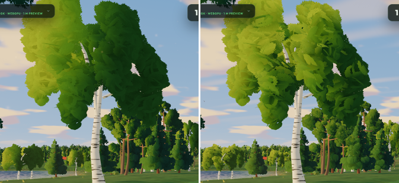
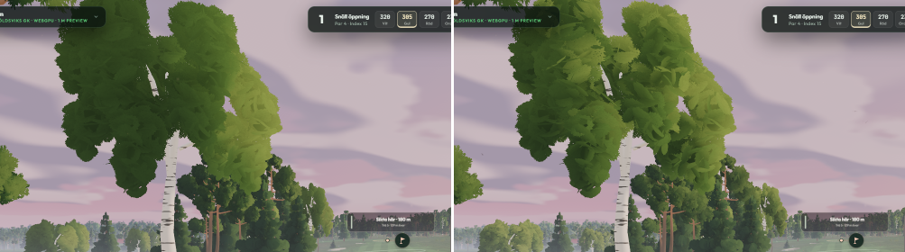
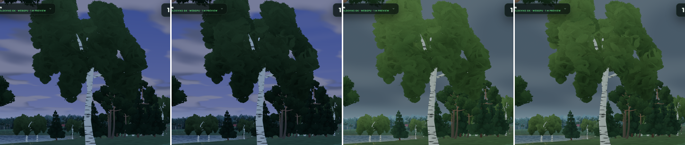
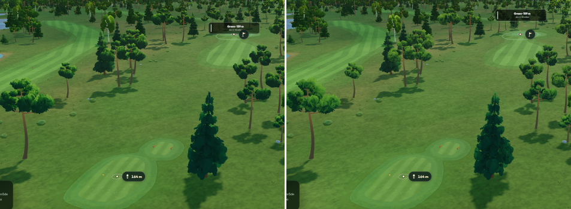

Leaves near a crown also flutter a couple of centimetres on their own phase,
as strongly as the air blows, gone by 40 m (`?leafflutter=0`).

## 4. Ground, sand and water

- **The bunker's hollow** (`ground-material-core.mjs` `SAND_BOWL`). A pale sand
  with an even dark lip round a bright middle read as a pillow, or a boulder.
  The sand is painted as the hollow it is: a bowl 0.55 m deep reached 2.4 m in,
  its slope from two more taps of the sand's own distance field (screen
  derivatives stair-stepped at each texel), lit by the sun against flat
  ground; the lip throws a crescent of shade onto the sand on the sun's side;
  the lip's band is deepest there and light on the lit face; and the sand is a
  warmer cream at every distance. `?sandbowl=0`.
- **The wind on the grass** (`one-wind.mjs` `windSheenAt`). The gusts the one air
  carries now lay the rough over as soft lighter patches crossing the course
  (two scales of the air's own gust quilt, periodic over its 400 m wrap): rough
  fully, fairways a third, greens not at all; the blades round the ball take
  the same term packed into their blotch varying (a fifth output would pass
  16). Still under reduced motion. `?windsheen=0`.
- **Bushes and stones** (`cover-shapes.mjs`) are painted forms instead of
  flat-shaded gems: a puffy bush lit as one clump, a rounded boulder; same
  extents, so the seating and prepared places hold. `?covershapes=0`.
- **The bank in the water** (`water-shading.mjs` `WATER_BANK`): the water a
  stride or two inside the bank darker and greener in each light's own water
  colour, so ponds lose their bright sticker rim. `?waterbank=0`.

- **Contact shadows** (`contact-ao.mjs`): three r187's GTAO on the scene
  pass's depth, which r187 reads under the reversed depth buffer, with normals
  rebuilt from depth (no second target), 0.9 m radius, at half resolution.
  Without temporal filtering its samples are grainy and every flat wall read
  a slight speckle: a 3 × 3 box takes out the grain, and only occlusion past a
  contact threshold darkens the colour, at most 0.55 of it, faded in from 2 m
  to 8 m from the eye (the rough's long blades near the lens shaded the
  ground just behind them into dark specks). Wall feet, tee
  markers, bushes, carts and the folds between crown masses gain their shade;
  painted planes stay clean. Joined before the bloom and god rays add theirs;
  high quality only; the same on WebGL2. +0.3–0.7 ms at 1080p. `?ao=0`.

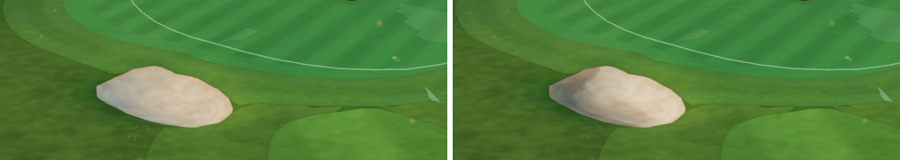
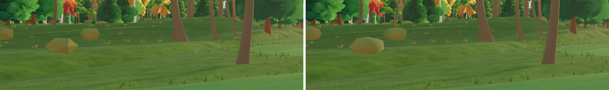
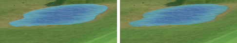
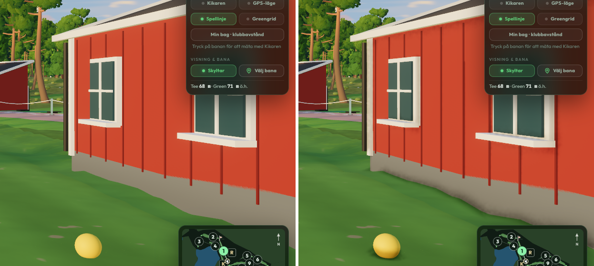
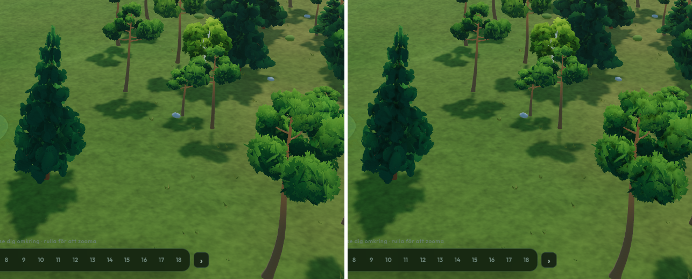

## 5. Sky and life

- **High cirrus** (`painted-sky.mjs` `CIRRUS`): wind-drawn streaks gathered into
  patches on a plane above the cumulus, faded at the horizon, the zenith and
  in the sun's glare, warmed toward a low sun; none in the storm, the mist or
  the cloudless summer day. `?cirrus=0`.
- **Birds** (`birds.mjs`, after Odyssey's flights and hinge-folded bird rig): six
  loose flocks of gulls wheeling 30–75 m up round the eye, one instanced draw,
  wings beating in bouts and gliding. `?birds=0`.
- **Butterflies** (`butterflies.mjs`, after Odyssey's meadow life): brimstone,
  cabbage white, common blue and small tortoiseshell weaving over the turf in
  the low views, faded by their size on screen. `?butterflies=0`.

- **Falling leaves in autumn** (`falling-leaves.mjs`): a few hundred birch,
  maple and oak leaves tumbling down through a box of air round the eye in
  Höst, each on its own pendulum, drifting on the one air, wrapped through the
  box so none pops, faded by their size on screen. `?leaves=0`.
- **Rain in the storm** (`rain.mjs`, after Grainfields' rain curtains): faint
  streaks a little longer than a frame's fall, slanted by the gale, in the
  overcast sky's colour, an additive overlay after the sky. Oväder only.
  `?rain=0`.
- **Meadow flowers in the rough** (`meadow-flowers.mjs`, after Odyssey's meadow
  life): drifts of oxeye daisy, buttercup, harebell, red clover and wood
  cranesbill round the eye, one instanced draw on a 0.5 m world grid. They
  grow only on the rough, read from the ground's exact class fields and the
  grass round the ball's ground grid, in drifts from a 6 m lattice noise, each
  drift mostly one species. A painter's flower (a stem and six petals round a
  heart, six notched petals a little larger than life) sways with the grass and shrinks away by
  28 m; autumn keeps a fifth of them. +0.13–0.19 ms. `?flowers=0`.
- **Swans on the lakes** (`swans.mjs`): a Blender-built mute swan (section 6);
  on each lake of open water near the course a pair or two, sometimes with a
  grey cygnet behind, gliding a slow loop. The loops are planned once from the
  water outlines: the deepest open water, 8 m off the shore at the nearest, no
  island or silt bank under the loop's reach, at most 16 a course (none on
  Visby, Tortuna or Lidingö, whose water is too small). Their places are
  closed-form in the clock, two instanced draws and a faint ripple ring after
  the water (order 7); no shadow, since the sun's map is redrawn on demand.
  `?swans=0`.
- **Herons in the shallows** (`herons.mjs`): a Blender-built grey heron
  (section 6), one to a pond near the course and at most four a course, 80 m
  apart, standing where the water is 6–32 cm deep within 1–4.2 m of the bank,
  facing out over the water and a little along it. Static instanced furniture,
  so it casts its shadow onto the bed. `?herons=0`.
- **Mist on the lakes** (`lake-mist.mjs`): the lakes' own water sheets near
  the course (their outlines and shore distances) merged into one geometry
  and drawn as three thin layers 0.3–1.6 m above the water, after it and
  writing no depth: wisps from the ground's detail texture at two scales, each
  layer drifting with the one air at its own rate, faded in from the bank and
  out near the eye, in the haze's colour warmed toward the sun. Dawn most,
  then Dis, the blue hour, the midnight sun, a little in autumn and at golden
  hour; none at noon, on the summer day or in the storm. Three draws.
  `?lakemist=0`.
- **Water lilies** (`water-lilies.mjs`): rafts of notched pads, one in seven
  with a white flower, in the sheltered shallows of ponds and small lakes
  (never the sea or a big open lake): a walk round each shore puts pads round
  a raft line 2–6.5 m out, where the water stands 0.25–2.2 m deep over the
  ground. Two instanced draws, at most 4,200 pads. `?lilies=0`.

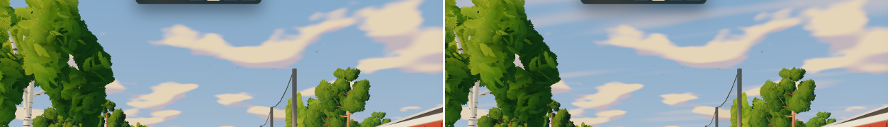
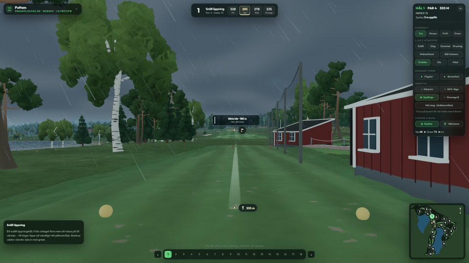
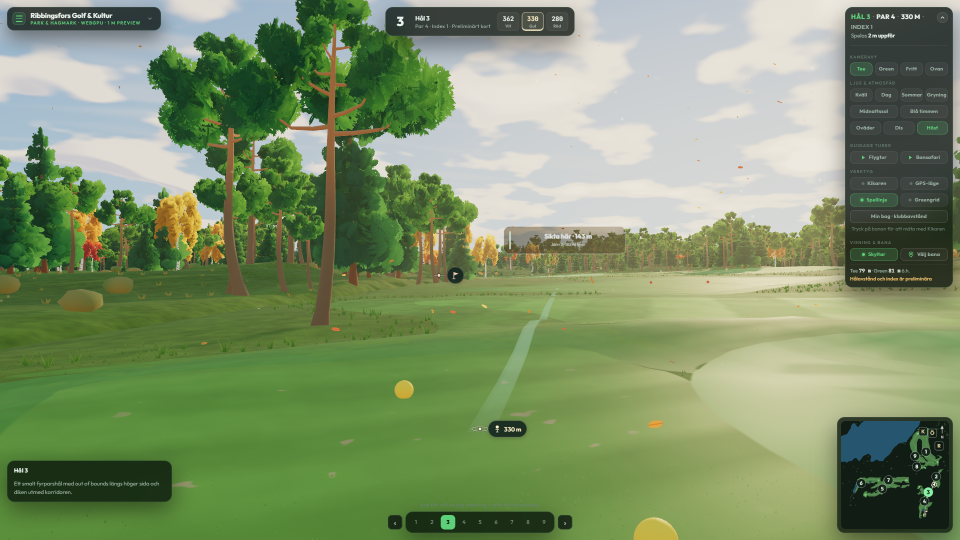
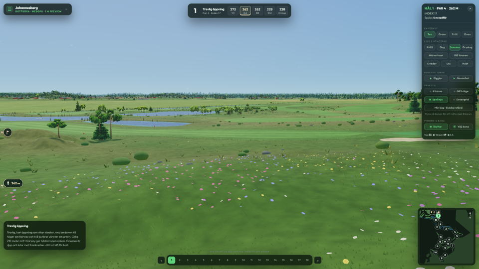

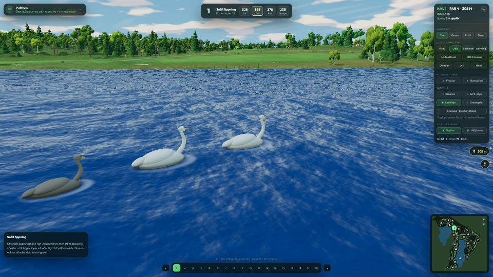
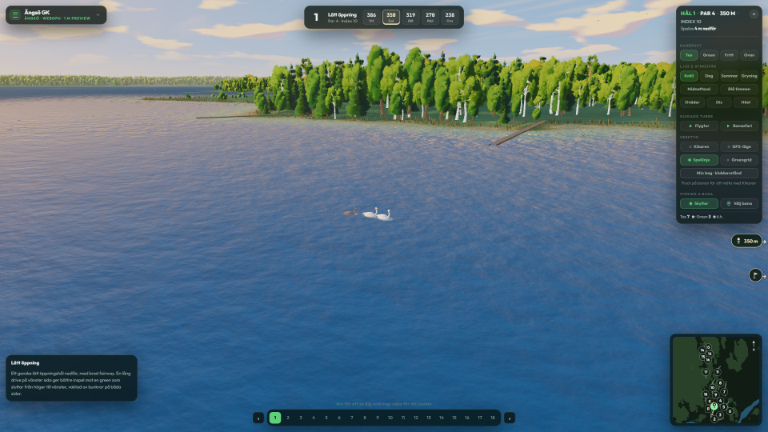
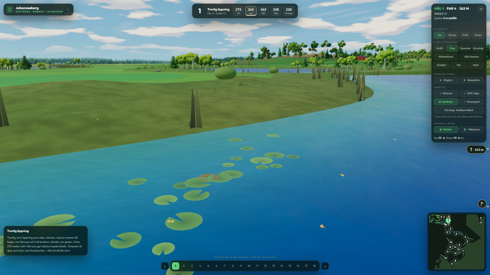
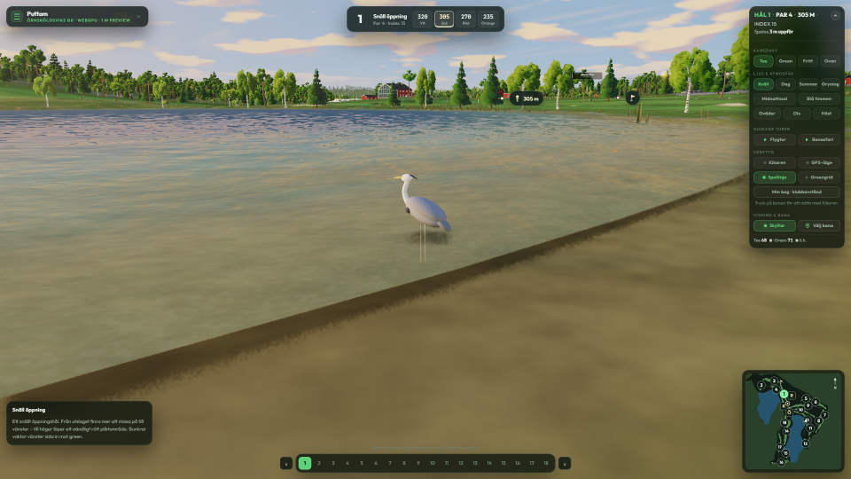
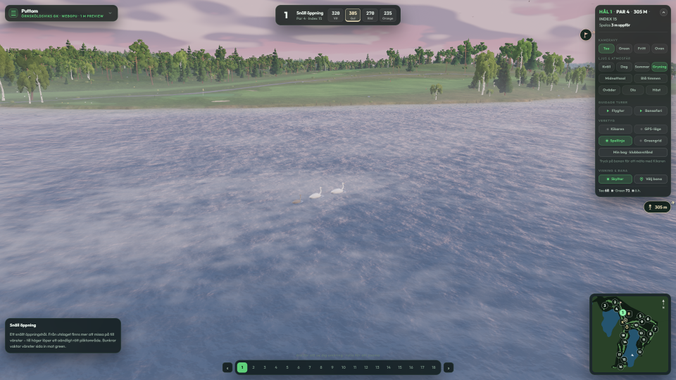

Every light's birds, butterflies, leaves, rain, flowers and cirrus share are
in their modules; no birds or butterflies fly in the storm, the mist or the
blue hour, and all of the life holds still under reduced motion and is pinned
under `det=1`. A hue-keeping tone curve (Grainfields'
`gfFilmic`) was A/B'd and left opt-in (`?tonecurve=filmic`): brighter greens,
but lifted shadows and flatter woods.

## 6. Props built in Blender (`tools/blender-props/`, `golf-cart-prop.mjs`)

Five painted props, each from a rebuildable script run through the Blender
MCP (Blender 5.2.2), exported as a content-addressed GLB with a JSON record in
`models/props/`, checked like the authored buildings (bytes, sha256, no
external URIs), cached by the service worker, and drawn as two instanced
meshes whose white body takes each instance's colour:

| Prop | Script | Triangles | Where |
|---|---|---|---|
| Golf cart | `golf_cart.py` | 2,396 | cart parks (Lidingo, Puttom, Ribbingsfors, Tortuna, Visby) |
| Estate car | `parked_car.py` | 1,908 | every car park and trunk road ("a car is two boxes") |
| Alcove motorhome | `motorhome.py` | 2,200 | Puttom's motorhome lot |
| Mute swan | `swan.py` | 2,400 | the lakes (section 5); painted by the smooth normal, so no facets |
| Grey heron | `heron.py` | 2,536 | the ponds' shallows (section 5) |

The tee markers are round painted balls instead of 8 × 6 faceted spheres
(`?teemarkers=before`). `?props=0` draws the boxes.

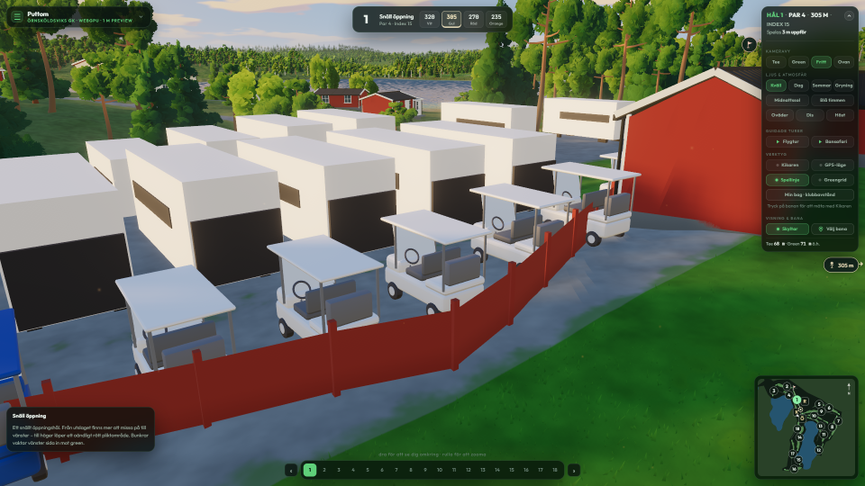
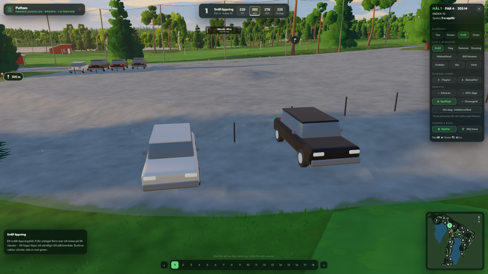
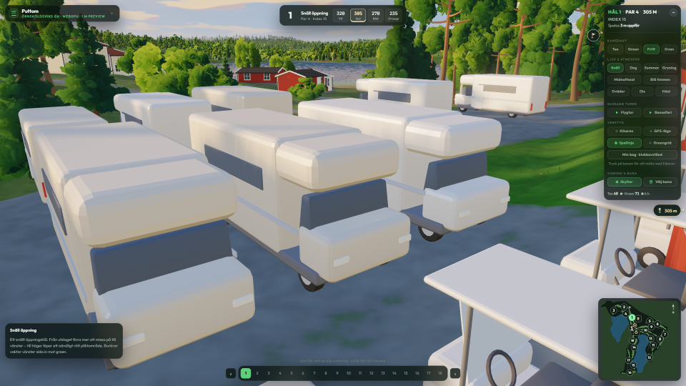
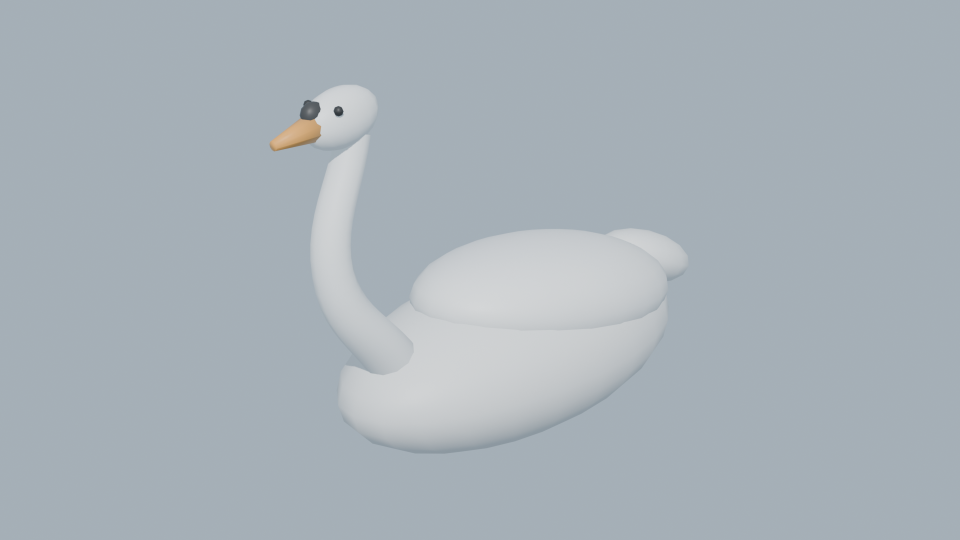
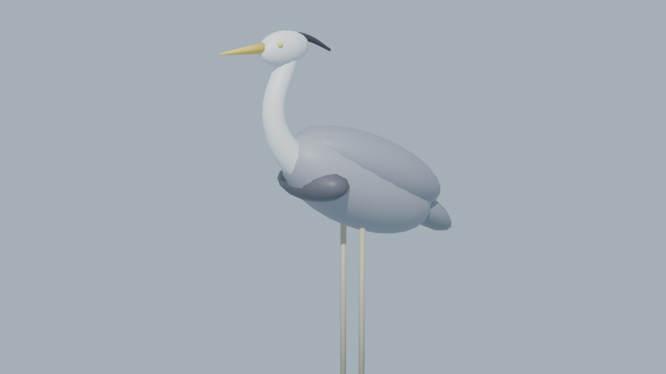

## 7. UI and UX

- The target's card (Green · 153 m) is capped at 0.26 of the screen's height
  wide and stands 44 px above its target on screen: from the Green view it was
  a slab over the green itself (`?labelcap=0`).
- On a desktop the rail folds to its hole summary behind a chevron
  (remembered; starts folded under 1500 px; `det=1` keeps it open), and the
  hole note folds to its title eight seconds after a hole change (hover, focus
  or a click opens it).
- A camera glide longer than 80 m arcs up through its middle (an eighth of the
  distance, at most 45 m), so a hole change reads as a short flight
  (`?camarc=0`).
- The loading cover shows the course's own poster, dim and drifting, behind
  the progress (still under reduced motion).

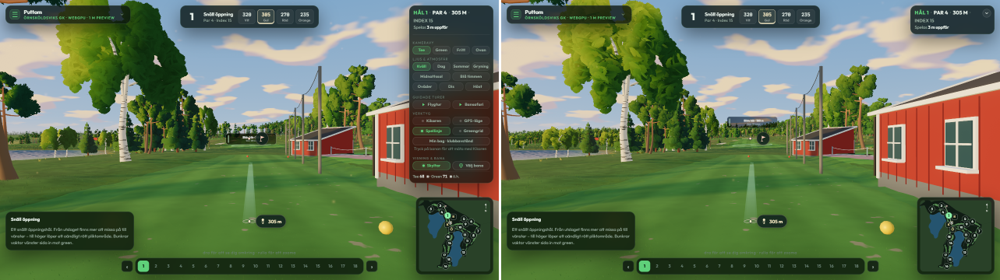
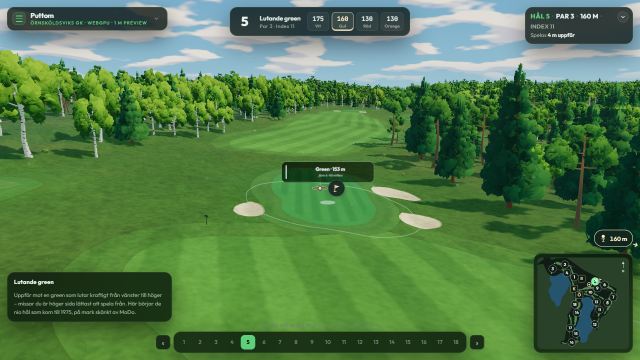
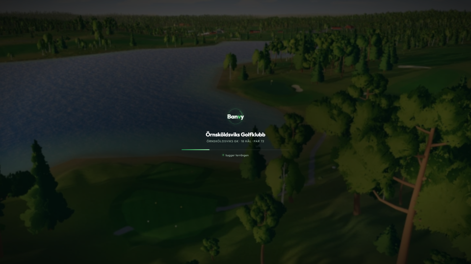

## 8. Tools

- `tools/gfx-gallery.mjs`: twelve fixed 1080p views on the real GPU with GPU
  milliseconds from timestamp queries (no uncapped rendering), `--lights` for
  one view through all nine lights, `--quality lo`, and `--compare a,b` sheets.
- `tools/check-gpu-clean-boot.mjs` (section 1).
- `tools/check-caddie-ui.mjs` reads the GPS hole view two animation frames
  after it opens: it had measured the camera's pose before the phone-sized
  resize applied, and failed the framing at 390 × 844 though the view was
  right.

## 9. Verification

At the final commit, on the RTX 5080 Laptop (Chrome 156, D3D12/ANGLE):

| Check | Result |
|---|---|
| Frozen lockfile install, `pnpm --filter @banvy/golf build`, `node tools/lint-app.mjs` | pass |
| `pnpm exec vitest run apps/golf` | **1369/1369**, 186 files |
| `pnpm test`, Vitest | **1639/1639**, 219 files |
| `pnpm test`, Node | **479 pass**, 0 fail, 3 skipped (Visby's `compile-stands` needs `copc-reader`'s own `npm ci` once) |
| `node packages/course-v2/check-app-build.mjs`, `pnpm check:course-workflow` | pass |
| `tools/check-prepared-startup.mjs` on the rebuilt app | pass, revision `2af034ff` (tint, vista, scatter and water re-baked after the last engine change; the earlier bakes' water fields removed) |
| `check-gpu-clean-boot.mjs --quality hi` | **26/26** clean: WebGPU boots 5.4–9.0 s, opening compile 0.68–0.81 s; WebGL2 4.0–8.4 s, 0.33–0.77 s; at most 15 vertex outputs |
| `check-gpu-clean-boot.mjs --quality lo` | **26/26** clean (before the guard, every WebGL2 course hung) |
| `check-hud-layout.mjs` | 51/51 |
| `check-chooser-ui.mjs` | pass |
| `check-caddie-ui.mjs` | **25/25** (the harness now reads the GPS hole view after the resize applies, section 8) |
| `check-hero-impostor.mjs` (Puttom hi, Visby lo) | Hero and Full routing, model requests and slots verified; the forced-Lite override (`setTreeLod(3)`) still leaves impostors drawn (9,598 hi, 17 lo), **the same on the build before any of the night's visual changes** (open, below) |
| GPU time, all of the night's features off (`?…=0`) against on, four views, two interleaved rounds | off 6.88/7.27/8.32/4.72 and 8.32/8.26/8.26/4.26 ms (mean 7.04); on 7.21/8.85/8.85/4.00 and 8.85/6.95/8.98/4.98 ms (mean 7.33): **+0.3 ms** at 1080p, inside the run-to-run spread |

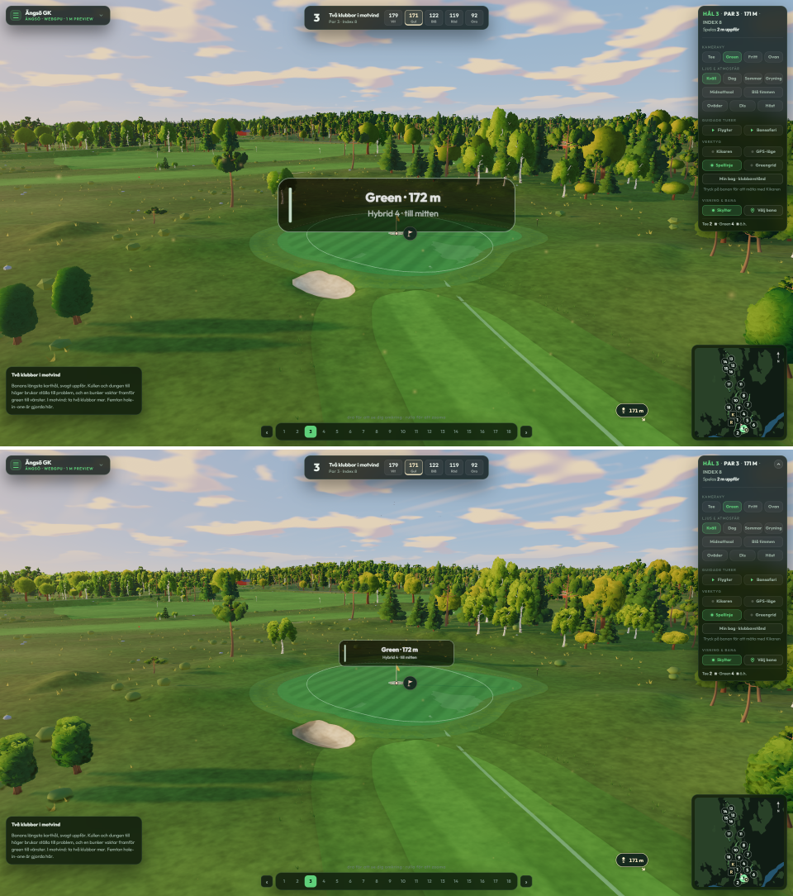
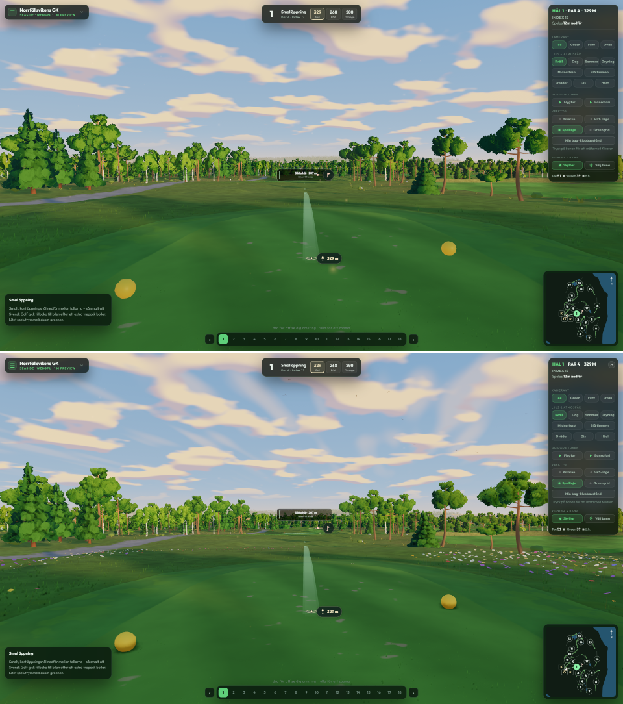
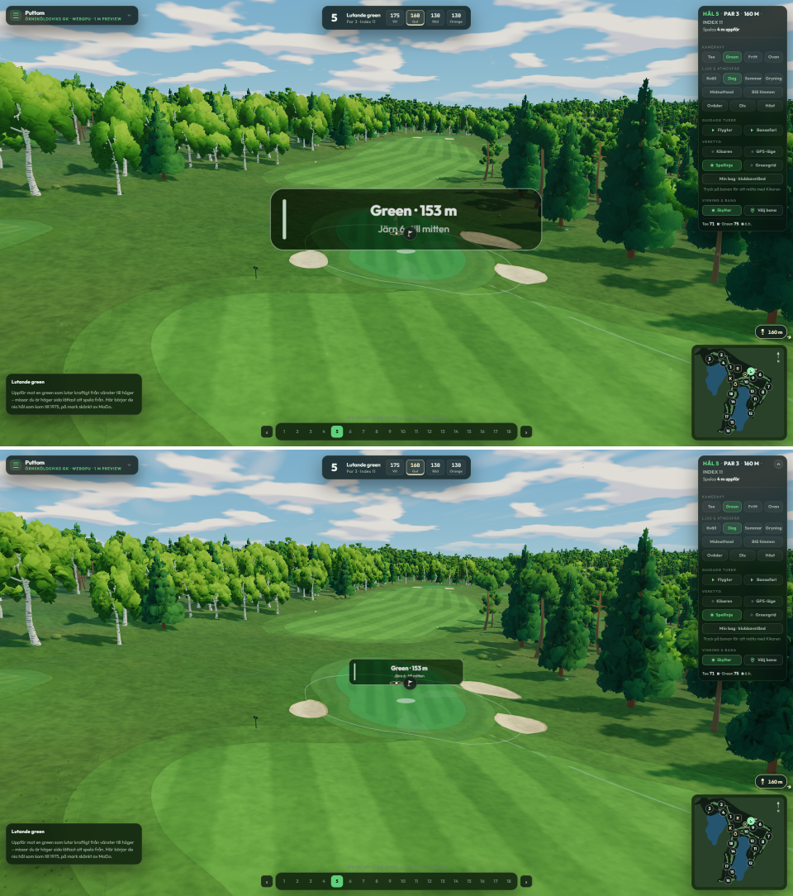
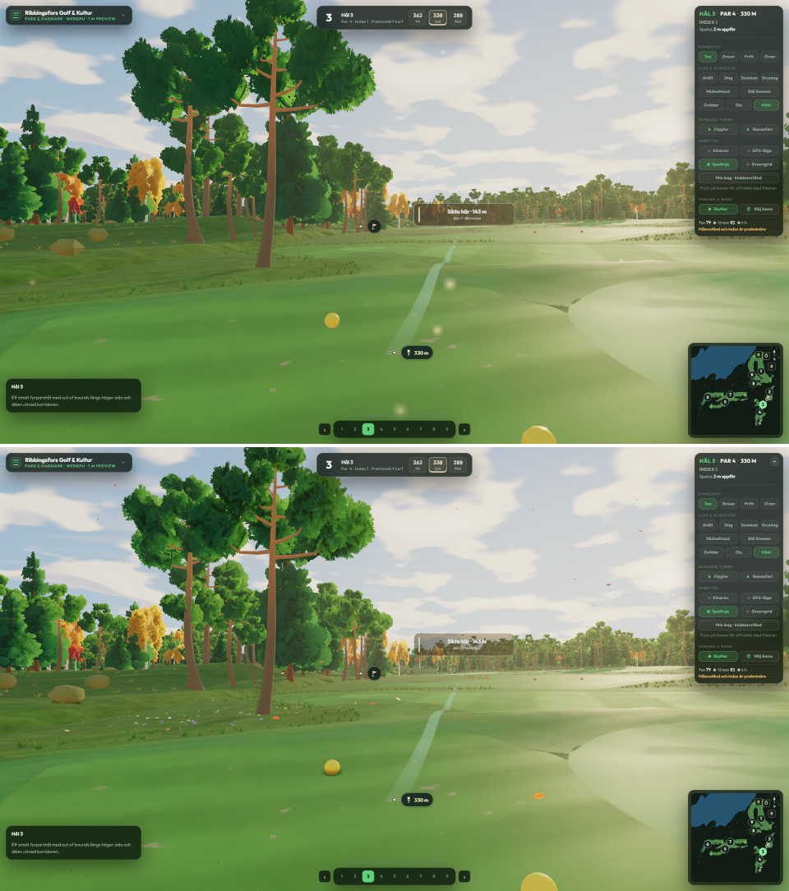

Reproduce the gallery: `node tools/serve.mjs apps/golf/dist 8620`, then
`BANVY_GPU=1 node tools/gfx-gallery.mjs --label after` and
`node tools/gfx-gallery.mjs --compare before,after`.

## Not done, for a next night

- **The canopy's form.** Tonight's canopy is light and shading; the silhouettes
  are the approved catalogue's. Odyssey's puff-seated leaf-card crowns as a new
  catalogue (`tools/blender-tree-study/`) behind `?treeset=v2`, re-baking the
  impostors and passing the tree-shadow, impostor and tier gates.
- **Reflections of land and trees in lakes** (Odyssey's `waterMarchLand`),
  replacing the tree-line band, needs the terrain's heights in the water shader.
- **The forced-Lite override** (`check-hero-impostor.mjs`): `V3D.setTreeLod(3)`
  should resolve to the near mesh with no impostors; it leaves thousands drawn,
  already before the night's visual changes.
- **The Hero tier's cost.** In Puttom's fifth from the Green view (noon,
  1080p) the frame takes 9.4 ms of GPU time with Hero crowns and 5.1 ms with
  `?treemesh=full`; god rays, the shadow grid, the canopy and the crown
  coverage are each under 0.5 ms. Hero at high quality is the owner's decision
  (24 September), so it stands; the evidence is here for the next tier review.
