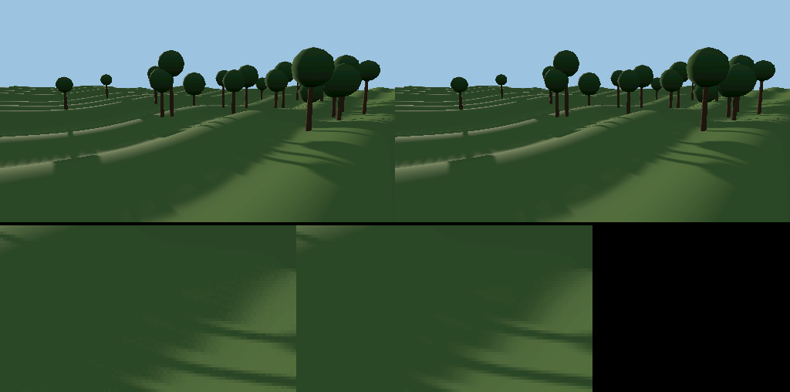
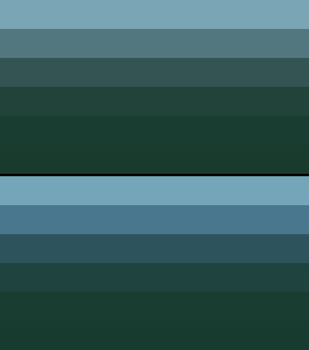
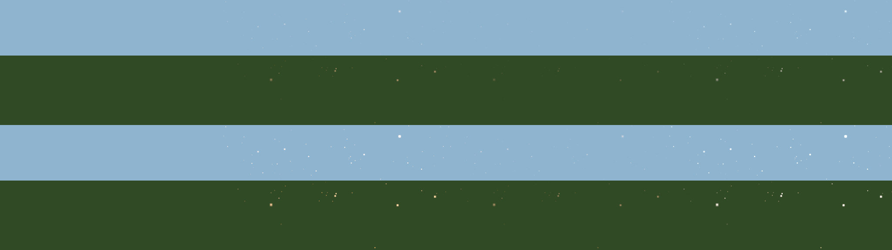
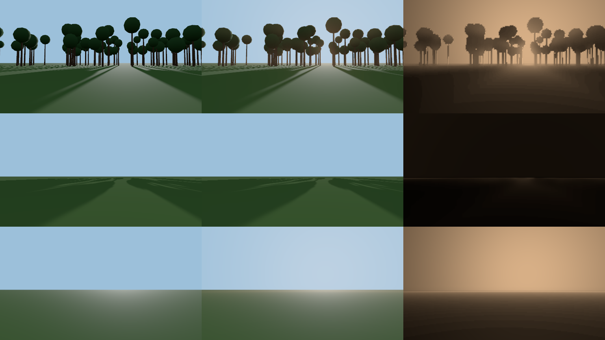

# Techniques from serenity-blocks, 2 November

**Owner request, 2 November:** "I know we really can improve the graphics to
make it absolutely stunning, i have done a lot of graphically amazing themes and
graphics in my other repository serenity-blocks" (after the
[r187 upgrade](three-r187-upgrade-2026-11-02.md)).

serenity-blocks is on the same stack (three 0.187.0, WebGPU with the WebGL2
backend, TSL node materials), so its techniques port as code, not as ideas. A
read-only survey catalogued them by golf element. This batch ports the three
that are self-contained, fill a gap here, and can be proved in isolated
scenes; each keeps its before behind a URL switch that leaves prepared startup
eligible, so an A/B pair differs only in the change:

`?shadowgrid=0&hazespectrum=0&airmotes=0&godrays=0`

Nothing here changes geometry, placement, source data, prepared data or a
light's tuned values. The isolated scenes below render the real shaders in
software on WebGL2 and WebGPU; full courses still need the owner's GPU, as do
the frame costs.

## 1. Soft shadows without grain (`sun-shadow.mjs`, `?shadowgrid=0`)

From serenity's `src/themes/shared/grid-shadow-filter.js`. three's PCF takes
five compares on a Vogel disc turned per pixel by interleaved gradient noise,
which a temporal filter is meant to average out. This app has no TAA, so under
a low sun, where nearly every surface sits at its own shadow's edge, every
penumbra carried a fine crosshatch. The grid filter takes a fixed grid of
compares, each already a 2 × 2 PCF because the map samples with LinearFilter:
nine at high quality, four at low (one fewer than three's five, where phones
draw). The grid's spacing matches the disc's mean squared radius (0.5 radius²),
so the penumbra keeps its width; serenity's own spacing was narrower.

[Isolated scene](graphics/shadow-grain-2026-11-02/) (rolling ground, trunks
and crowns, sun 7° up, 1024² map), on the ground the nine-tap grid draws smooth:

| Radius | PCF: share of those pixels grainy | four-tap grid | penumbra, blurred, vs PCF |
|---|---|---|---|
| 1 (the app's; three's default) | 2.1% | 0.4% | 0.007/255 (nine), 0.010 (four) |
| 3 (stress) | 6.0% | 2.0% | 0.04/255, 0.11 |



Cost: four more compares per shaded pixel at high quality, one fewer at low.
Not yet timed on hardware.

## 2. Distance turns blue (`aerial-perspective.mjs`, `?hazespectrum=0`)

From serenity's High Coast light (`HAZE_SPECTRUM`). The haze laid one amount
over every channel, so far wood went grey. Air scatters blue more than red, so
the haze's optical depth is now scaled per channel, red 0.7, green 1, blue
1.45, for the exp² haze `T_c = T^k_c`. Green is the haze exactly as tuned, and
at infinity every channel reaches the same ceiling (`hazeMax`), so the land
still meets the sky's band under the horizon in the same colour. The valley
mist is water droplets and stays grey. The red and blue offsets from green vary
slowly with distance, so they are reckoned per vertex and added per pixel
(crowns shade no more per pixel). The water's reflected far shore
(`nordic-water.mjs` `treeLineColour`) takes the same haze.

[Isolated ridges](graphics/haze-spectrum-2026-11-02/) of the spruce's darkest
pigment at 150 m to 8 km, under five painted lights, linear before tone
mapping: green identical at every range; blue ahead of red at every finite
range; the largest change +0.03 to +0.06 linear in blue at 1.8–3.5 km under
the clear lights; and none where the haze saturates (blue hour at 8 km, mist
from 3.5 km). The clear lights' haze is too thin to saturate within 8 km.



## 3. The air's motes (`air-motes.mjs`, `?airmotes=0`)

From serenity's Odyssey air motes. Pollen and a seed's down in a box of air
round the eye (40 × 16 × 40 m, standing on the ground under it): one instanced
draw with no instance data, 900 motes at high quality and 360 at low, each
placed from its index in a world-anchored lattice, so a flight streams through
them. They ride the one air (`one-wind.mjs`): pollen with it, down at 0.6 of
it, each drift wrapped to the box so a wrap never pops; they hold still under
reduced motion, as the plants do, and their clock and drift are pinned under
`det=1`. Toward a low sun they light up like dust in a sunbeam. They fade near
the lens, at the box's edge and as the eye climbs past 20–45 m, as the grass
round the ball does. Each light sets its air in `AIR_MOTES.presets`: the
storm and the mist have none, blue hour very little. They are an additive
overlay at render order 3, after the sky.

[Isolated field](graphics/air-motes-2026-11-02/), eye 1.7 m up, sun 8° up:
motes only add light; they add about 4.2 times more with the sun ahead than
behind; the storm adds nothing; and no mote draws over 56 pixels. The check
first caught a shader fault (a node multiplied by a JavaScript number, `NaN`
in the generated WGSL and GLSL) that blanked the whole WebGPU frame.



## 4. God rays through the trees (`god-rays.mjs`, `?godrays=0`)

**Owner request, 2 November:** "Do the god rays through the trees first."
From serenity's forest-family lens (`src/themes/golden-forest/golden-forest-post.js`),
on three's `GodraysNode`. The scene pass's depth gives each pixel's ray; the node
marches it through the sun's own shadow map at half resolution (24 steps,
jittered) and returns how much lit air it crossed, `1 - exp(-integral)` under a
ceiling, so where the crowns shadow part of the way the shaft breaks into beams
and gaps; a bilateral blur takes out the march's noise without bleeding across
silhouettes. The crowns' shadow map is cut through their leaf cards
(`maskShadowNode`), so the real woods give dappled beams.

Golf's choices, where serenity's differ:
- **Forward scatter from each pixel's own ray.** Serenity weights the shafts by
  the sun's position on the screen; here the lobe round the sun comes from the
  view ray (`godRayLobe`, power 6 over a floor of 0.08), so it works with the sun
  off the screen and in every camera view.
- **The veil.** Serenity found the march lays lit air over the far ridges and
  the sky where the shadow box runs out, and cut the shafts past the far forest.
  Golf's box follows the eye at 260 m to over 1150 m, so the cut is a share of
  its half-width (45–85%, `SUN_BASIS.R` once a frame), past which only the glow
  round the sun is kept; the haze and the sky carry the distance.
- **Each light's shafts** (`GOD_RAYS.presets`): golden 0.5, dawn and midnight
  sun 0.45, autumn 0.35, summer 0.25, noon 0.2; none in the storm, the mist or
  the blue hour, whose suns are hidden or down. A light with none runs neither
  the march nor the blur (gated subclasses of three's nodes).
- **Density** 0.3 per 100 m of lit air and a ceiling of 0.5, serenity's order
  of magnitude, so the 30–100 m of air in front of a wood's edge shows its beams.
  At first tuning for kilometre paths (0.08) the near air barely registered.
- **High quality only.** Low quality has no post pipeline, and the runtime drop
  draws straight to the canvas, so neither pays.
- **When the graph is built.** `GodraysNode` reads the shadow map while its
  graph is built, so `main.js` joins the shafts to the output once the map
  exists: before the first frame after the opening scene's compile, or on the
  frame after the first under `?startup=0`. A failure is caught and logged, and
  the course draws without them. `V3D.godRays()` reports their state.

[Isolated scene](graphics/god-rays-2026-11-02/): a band of wood between the eye
and a sun 7° up, the app's own sun-shadow filter, a 4× MSAA scene pass and the
composite, on WebGL2, WebGPU, and WebGPU with reversed depth (the app's WebGPU
default). The shafts' light (each shot less the same shot with them off):

| | WebGL2 | WebGPU | WebGPU, reversed depth |
|---|---|---|---|
| light added toward the sun / away | 5492 / 145 | 5489 / 144 | 5489 / 144 |
| storm: added, march run | 0, no | 0, no | 0, no |
| beams: variation along the air in front of the wood, wood / open field | 0.311 / 0.011 | 0.312 / 0.011 | 0.312 / 0.011 |
| pixels darkened | 0 | 0 | 0 |

The three backends' shafts agree within 1.4%.



Cost: one half-resolution march of 24 shadow-map samples a pixel plus a
two-pass blur at half resolution and one full-resolution composite. Not timed
on hardware; measure it with `tools/frame-time.mjs` and the switch.

## Considered and not ported here

- **Water depth ramp and soft shore** (Odyssey `waterRampBody`, `lakeWetLip`):
  the water batch already has teal shallows, olive weed and blue depths,
  tuned to Swedish ponds; serenity's ramp is turquoise island sea.
- **Colour grade, vignette and tone curve** (forest-family post, Grainfields
  `gfFilmic`): the owner removed a global grade because it clipped the greens
  and made the qualities disagree; a new curve retunes all nine lights.
- **A painterly Kuwahara pass, volumetric cumulus, birds and waterfowl with
  wakes**: striking, but each needs the owner's GPU for cost and taste before
  it is worth porting (serenity keeps Kuwahara to premium tiers).

## Reproduce

```sh
node docs/graphics/shadow-grain-2026-11-02/check-isolated.mjs
node docs/graphics/haze-spectrum-2026-11-02/check-isolated.mjs
node docs/graphics/air-motes-2026-11-02/check-isolated.mjs
node docs/graphics/god-rays-2026-11-02/check-isolated.mjs
pnpm exec vitest run apps/golf/src/engine/sun-shadow.test.mjs apps/golf/src/engine/aerial-perspective.test.mjs apps/golf/src/engine/air-motes.test.mjs apps/golf/src/engine/god-rays.test.mjs
```

`BANVY_CHROME` selects a Chromium; `BANVY_GPU=1` uses the real adapter.
