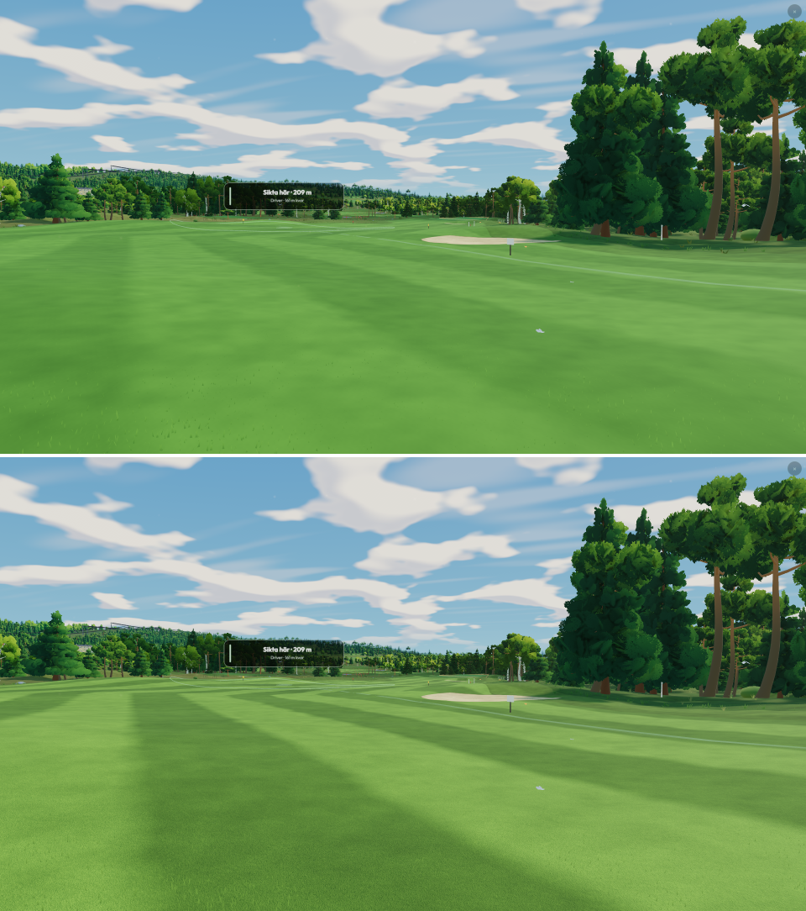
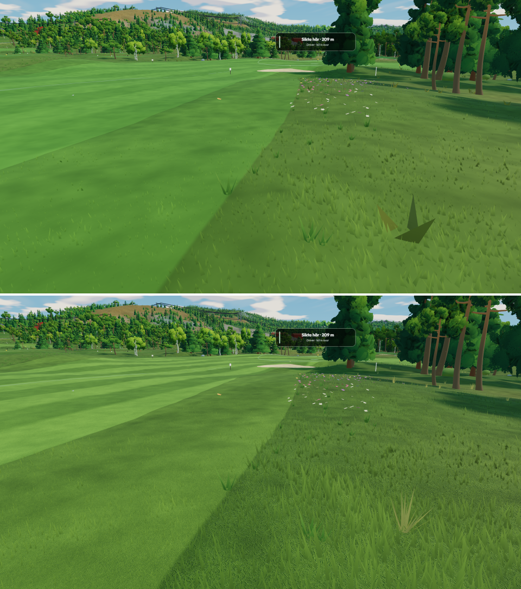
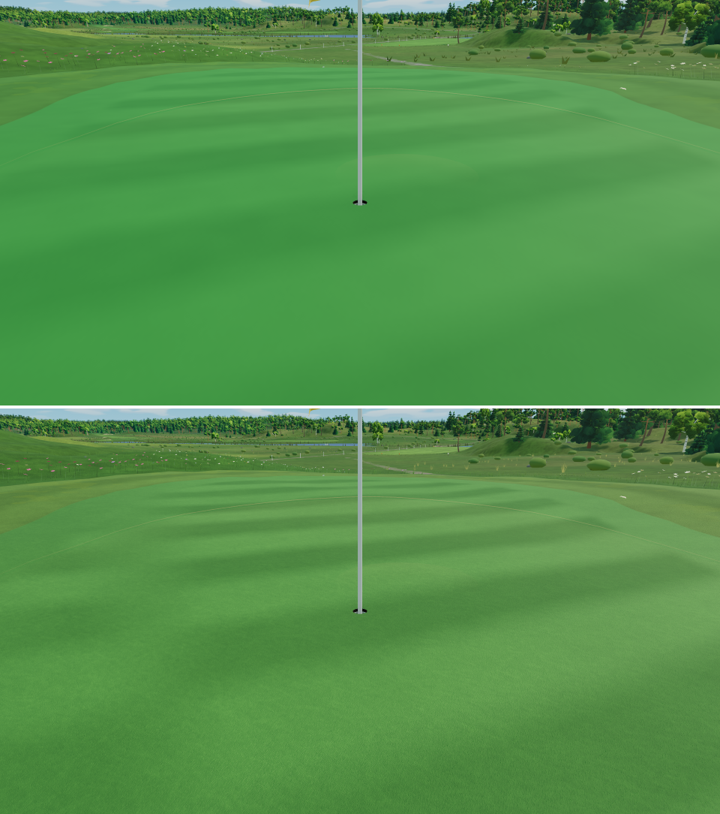
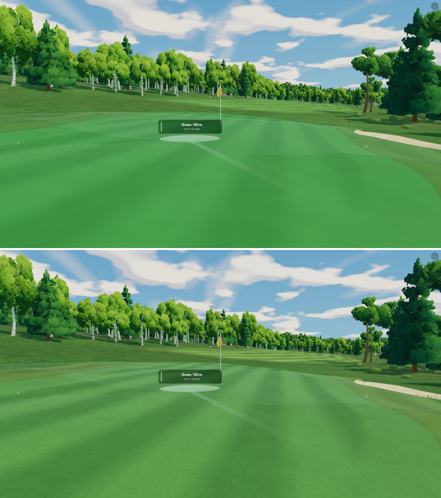
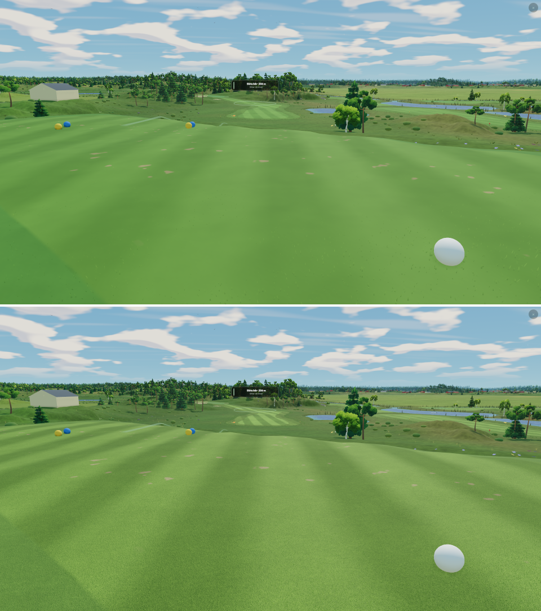
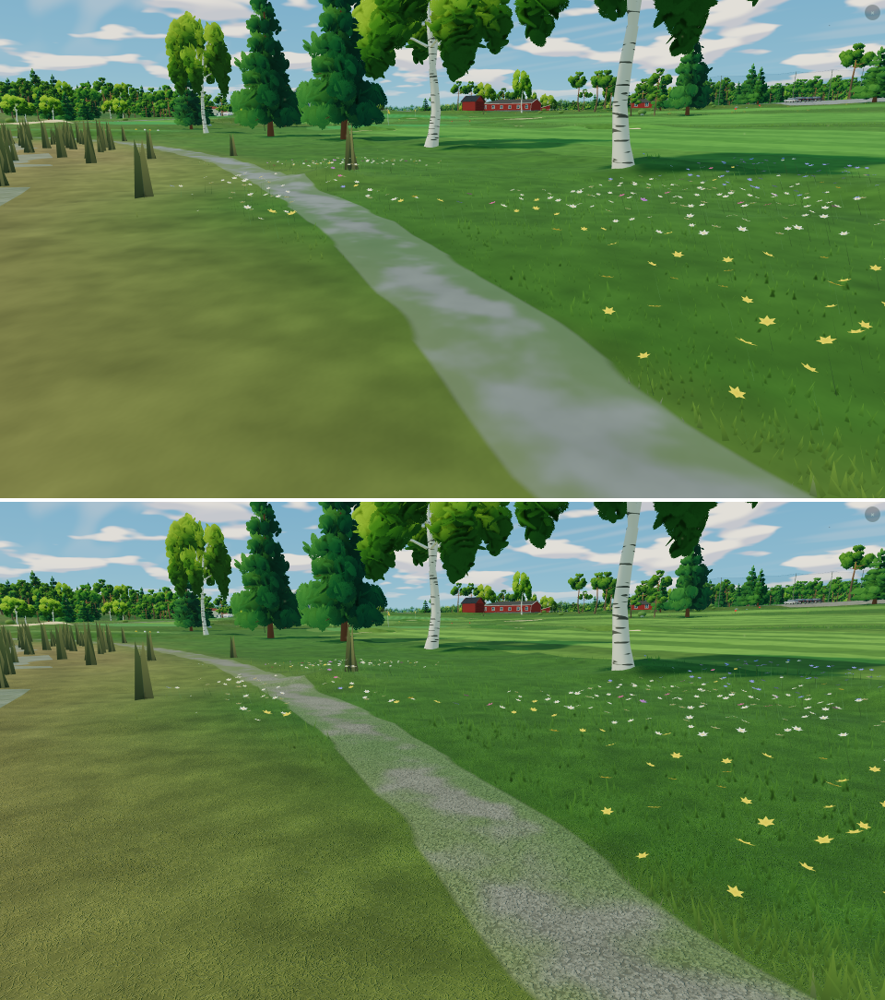

# The tour turf, 3 November

**Owner request:** "focus entirely on the grass now! I want it to look like the
EA Sports PGA Tour 2K25 game, … absolutely stunning for the tees, green, rough,
fairways and all other ground material as well, like the moss, gravel, roads."

The ground was painted: each surface a colour, metre-wide clumps and blotches,
and soft stripes. From a tee or on a green there was nothing between those
blotches and the pixel, so a fairway read as a coloured sheet and a green as
felt. The painted green sat at 123° of hue on screen (teal), and the stripes
were a few per cent either side.

This batch keeps the same pipeline (the class-SDF ground, its exact edges,
stripes, wear, sand bowl and near grass) and lays a tour turf over it.
`?turf=painted` is the whole before. It is measured on the RTX 5080 at
1920 × 1080.

## What changed

- **Turf detail texture** (`turf-detail.mjs`): 512 × 512, tileable, made at
  load in about 0.1 s from a seeded generator, mip-mapped with 16× anisotropy.
  One material per channel, each centred on 128:
  - R: mown blades laid one way;
  - G: wild blades in clumps;
  - B: packed gravel pebbles;
  - A: sand grain.
- **The turf's grain and bump** (`turf-look.mjs` `tourTurf`). Each class takes
  its material's channel:
  - the fairway, semi, tee, fringe and green take the mown blades, turned onto
    each hole's own mowing direction so the grain runs with the stripes; the
    green at about half the fairway's strength;
  - the rough, forest floor (moss), heath and wetland take the wild blades;
  - sand, the shore, mud and asphalt take the grain;
  - paths, gravel, soil and rock take the pebbles.

  Bright blades are a little warmer and gaps a little cooler, and a coarse
  6 m tap breaks the repeat. The same values perturb the terrain's normal
  (a screen-derivative bump), so a low sun picks out blades and pebbles. All
  of it fades by the pixel's footprint, so far ground keeps its tone and
  cannot shimmer.
- **Broadcast stripes.** The fairway's passes are 0.11 display either side
  (from 0.05). Every straight pass swaps light and dark as you turn: a pass
  laid away from you is light, one laid toward you dark. A green's passes,
  35° off the hole, swap by their own bearing.
- **The tour grade** (`TURF_LOOK.grade`), a per-class multiplier in linear
  light. The ground and the blades round the ball take the same one, so a
  blade keeps its root's colour.

  | Surface | Hue on screen, before → after |
  |---|---|
  | Fairway | 100° → 91° (warmer) |
  | Green | 123° → 107° (still cooler than the fairway, no longer teal) |
  | Rough | 90° → 81°, darker |

  Paths and gravel are warm stone instead of pale blue-grey, and asphalt is
  darker. The painted finish's two-tone hue band is mostly taken off turf
  (`TOUR_TURF_FINISH`).
- **The rough round the ball** (`near-grass.mjs` `NEAR_GRASS_TOUR`): at high
  quality it grows seven finer, taller blades per cell instead of four (rough
  12 cm, a fifth as wide as long). Low quality is unchanged.
- **Tussocks** (`ground-cover.mjs` `tourTussockBlades`): fourteen narrow
  blades from a tight crown, in place of three 26 cm triangles that read as
  paper fans up close.

## Cost

GPU time, four views, two interleaved rounds against `?turf=painted`: mean
8.35 → 8.54 ms, **+0.2 ms** at 1080p. Clean boots on WebGPU and WebGL2, high
and low quality, at most 15 vertex outputs.

## Pictures

Each sheet is before (`?turf=painted`, top) and after, from the same pose at
noon (`det=1`).

## Tools

`tools/goldens/gfx/turf-probe.mjs` (ignored, local) photographs a hole from
fixed ground-level poses: fairway, green, rough, putt, teebox, path, track,
road and bunker. It uses two new harness reads, `V3D.groundAt(x, z)` and
`V3D.groundFeaturesNear(x, z)`.

## Open

- A green glow in the trees at Veckefjärden's 13th in the midnight-sun light
  is the low sun through a crown, with bloom. It is the same with
  `?turf=painted`, so it predates this batch.
- The draped asphalt roads (with their markings) are their own meshes and do
  not take the turf's grain.
